# PR Review Inbox

Local-first PR review inbox for Bitbucket Server and Data Center, with AI code review by your own Claude Code CLI.

[](https://github.com/auric/pr-review-inbox/actions/workflows/ci.yml) [](LICENSE)

PR Review Inbox is a local-first review loop for Bitbucket Server and Data Center pull requests. It runs your own Claude Code CLI on your machine and can read the linked Jira issues. One inbox shows the pull requests that need you, and AI runs draft review comments, replies, and fix proposals. Nothing posts until you click, and support for other forges may follow.

Repository: https://github.com/auric/pr-review-inbox

<picture>
  <source media="(prefers-color-scheme: dark)" srcset="docs/screenshots/inbox-dark.webp">
  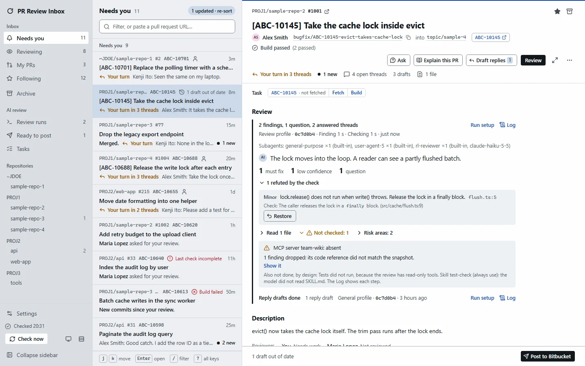
</picture>

## Why "PR Review Inbox"

The name says what the app does. It is one inbox for the pull requests that you review or that you wrote. A review is a loop: you review, the author changes the code and replies, and you check again. The app keeps each round of that loop in one place. The name names no forge, because other forges may follow. Its earlier names were Review Loop and Kierto.

## What it does

- Shows every open pull request that needs you in one inbox, with unread marks and a reason per row.
- Tracks each discussion per message: new comments, edits, replies, and deletions. Read state survives restarts.
- Notifies you once when someone replies to you or pushes new commits.
- Runs a Claude Code review on a sanitized snapshot of the pull request. The review reads the whole repository, not only the diff.
- Turns findings into drafts with a severity. You accept, edit, or discard each one, then post them as inline comments.
- Drafts replies to the threads where it is your turn. On your own pull request, it proposes fixes that you review before they touch your clone.
- Explains a pull request on its own page: what to read first, a walkthrough with links into the diff and diagrams, and the risks on their code.
- Builds a Jira task: Claude asks a few questions, writes a short plan, and builds the code with tests in a copy of the repository that the app owns. The pull request opens only when you click.
- Lists what the review did not check, so a gap never looks like a pass.

## Safety model

- PR Review Inbox runs on your machine and listens on 127.0.0.1 only. It checks the Host and Origin of each request, and each change needs a session token.
- Reviews use your own Claude Code CLI with your claude.ai login. PR Review Inbox removes `ANTHROPIC_API_KEY` and `ANTHROPIC_AUTH_TOKEN` from the child process.
- Nothing goes to Bitbucket until you click. PR Review Inbox posts your accepted drafts. Claude never posts.
- Claude never runs in your clone. Reviews run on a sanitized snapshot with read-only tools. PR Review Inbox never pushes your branches.
- Build a Jira task is the only part that changes code or pushes. Claude edits files only in a worktree that the app owns, the app runs only the commands that you approved, and it pushes only the branch of the task when you click "Push and open PR". It never pushes to the target branch.
- Your Bitbucket token goes into the OS secret store. It never goes into the database, logs, URLs, or prompts.

## Requirements

- Windows or Linux.
- The `claude` CLI, logged in with a claude.ai subscription. Check with `claude auth status`.
- A Bitbucket Server or Data Center personal access token with Project read and Repository write. PR Review Inbox needs write only to post comments, to resolve or reopen threads, and to push the branch and open the pull request of a Jira task.
- `git` on the PATH.
- Bun 1.x, only to build from source.

## Install

No release is published yet. Build PR Review Inbox from source with Bun 1.x:

```sh
bun install
bun run build
bun run start
```

For one self-contained binary, run `bun run compile`. It writes `dist/bin/pr-review-inbox-<os>-<arch>` for this host.

Release binaries: when a release is published on the GitHub Releases page, download the binary for your system and start it. Each release holds one binary per target, `SHA256SUMS`, and the license files. `bun run release` makes them.

```sh
./pr-review-inbox-0.2.0-linux-x64       # Linux: chmod +x it first
pr-review-inbox-0.2.0-windows-x64.exe   # Windows
```

To try PR Review Inbox without a Bitbucket server, run `bun run demo` from source and open http://127.0.0.1:7399. The demo uses synthetic data, a temp data folder, and memory secrets.

## First run

1. Open http://127.0.0.1:7317.
2. Enter your Bitbucket URL and access token, then click Save. PR Review Inbox tests the connection first.
3. Optional: in Settings, Jira, connect Jira. The review brief can then fetch the task text. The first "Include in runs" on a task attachment, or the first attachment box of a Build task, asks you to confirm your company AI policy. "Ask before Claude reads a Jira attachment" in the same section asks again.
4. The inbox lists the pull requests on your Bitbucket dashboard. To follow another one, paste its URL into the filter.
5. Open a pull request and press `r` to open the review brief. Add a note. With two or more review profiles, pick one.
6. Click Start review, or press `Ctrl+Enter`.
7. Triage each draft: `a` accepts, `e` edits, `d` discards.
8. Press `p` to post the accepted drafts. PR Review Inbox shows a confirm first.

## Features

### Review profiles

A profile sets the prompt, the checks, the volume, the model, the effort, the reviewer agents, the check step, the skills, and the MCP servers of a run. PR Review Inbox ships Review and Explain. An update removes the old Security and Over-engineering profiles when you never edited them, and keeps them when you did. Skills and MCP servers come from your Claude Code config. "Improve prompt" proposes a clearer prompt, and you see the changes before you apply them.

The checks add checklists to the review: Security, Threads and races, Performance, Tests, Compatibility, Simplify (what to delete), Docs and comments, Project rules, Matches the task, and the language checklists for C++, C, and Python. The check step reads the code of each finding again and confirms it, refutes it, or marks it unsure. You can turn it off or give it its own model and effort.

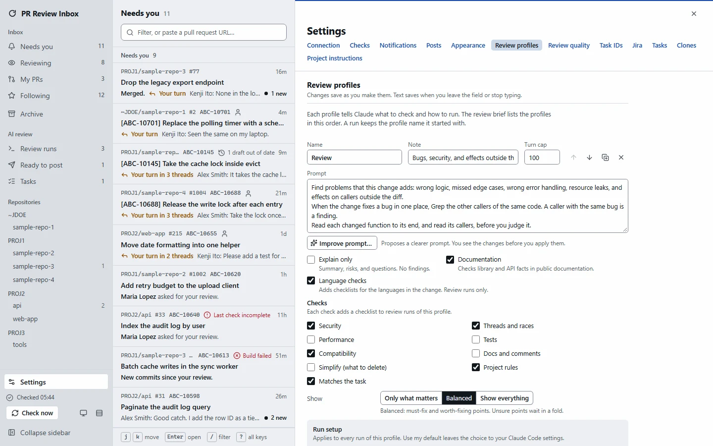

The review brief holds the task, your note, the checks, and the volume: "Only what matters", "Balanced", or "Show everything". A change of a check or of the volume saves to the profile at once. The profile picker shows when you have two or more review profiles. Explain has its own page. A review starts only from the brief.

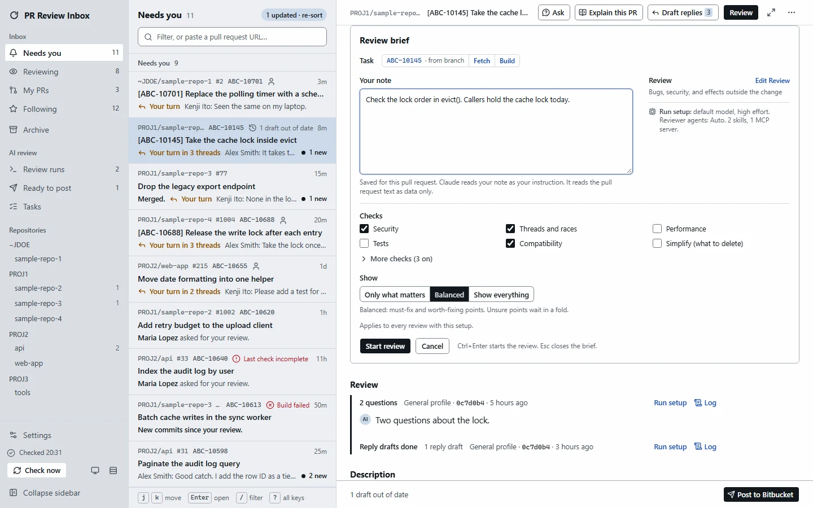

### Drafts and posting

A review has two steps. The run line says "Finding problems…" and then "Checking 9 findings…". A finished review shows the time of each step. Each finding becomes a draft with its title, its code, its severity, a check chip ("Checked", "Low confidence", or "Not checked"), the case that triggers it ("When:"), the reason of the check, and its evidence. Only you see drafts until you post them.

The Drafts header and the review record count the open drafts in plain words, for example "2 must fix · 3 worth fixing · 4 low confidence". The volume of the run decides what waits in a fold. "Balanced" puts unsure points and nits into "Low confidence". "Only what matters" puts everything but must-fix points into "More". "Show everything" has no fold. A run keeps its view after a volume change.

The review record lists the points that the check refuted or found twice, with the reason of the check and Restore. A restored point goes back into the Drafts list and says "You restored it". When the check does not finish, the record says how many findings are not checked. The record also lists what was not checked and why a finding was dropped.

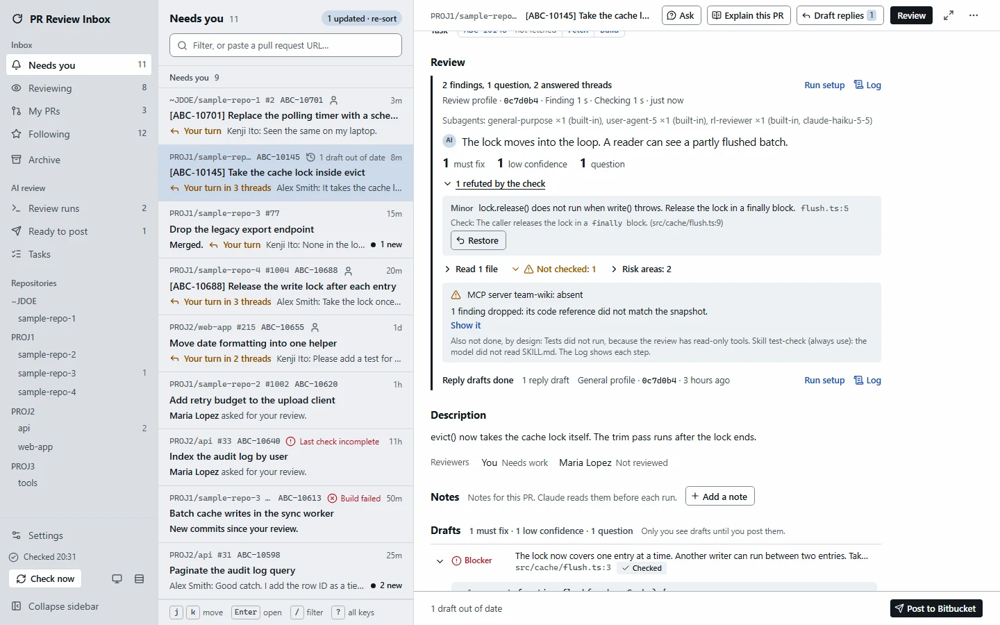

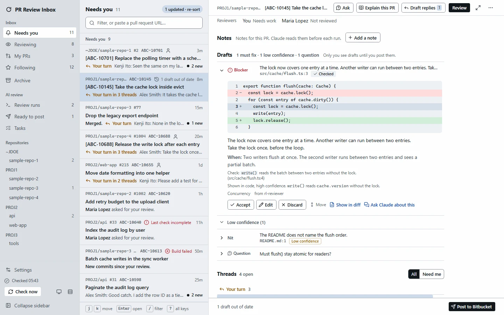

After you discard a finding, its card offers optional reasons: Not a bug, Not worth fixing, Duplicate, Intended, and Wrong place. One click saves the reason. The reasons leave on your next triage action.

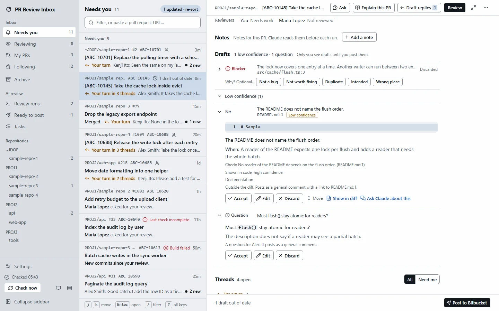

Settings, Review quality, counts your triage of the last 30 days per profile and prompt version: shown findings per run, the accepted share of the shown findings, discarded by reason, posted, addressed, and outdated. Accepts from a fold count apart. Addressed means that the thread of a posted finding is resolved or has a "Fixed in" draft. Outdated means that the commented code changed after the post.

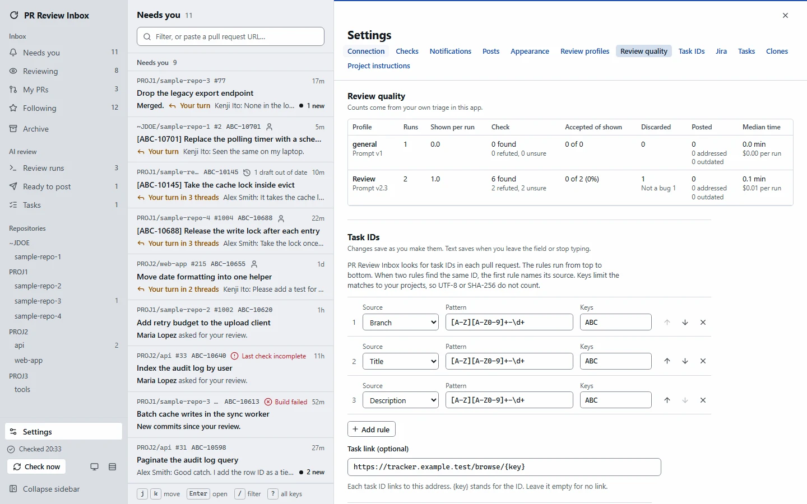

A review and "Review changes since" also read the answers to the questions that you posted. An answer that settles a question gets a reply draft with "Resolve after posting" proposed. A partial answer gets a reply draft with the next question. An answer that shows a real problem gets a new finding and a reply draft that points to it. The general comment with several questions gets one reply, and it proposes the resolve only when every question is settled. Unanswered questions get no draft. Explain does not read the answers.

The run log shows each tool call of the review and of its subagents. The calls of the check step show under "Check".

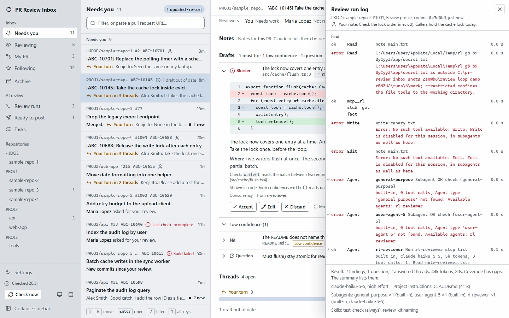

### Ask Claude about a finding

Each finding card has "Ask Claude about this". The key `t` opens the same talk under the card, with the focus in its box. Ask why, push back, or add context, then press "Ask" or `Ctrl+Enter`. Each message is one run, and Claude reads the code again before it answers. The answer starts with "Claude keeps this point", "Claude changed this point", or "Claude withdrew this point", and gives the reason.

A changed point shows the new text on the card as a word diff against your text. "Use the new text" makes it the finding, not accepted. "Keep mine" drops it. A withdrawn point moves to the discarded drafts with its reason, and Restore brings it back. On a posted finding, the More menu of its thread has "Ask Claude about this comment". The answer can draft a reply in the thread, marked "from your talk with Claude". Nothing posts until you accept and post it. A talk takes up to 20 messages. When the finding changes while Claude works, the answer applies nothing and says so. `Esc` closes the talk. The talk stays for the next open.

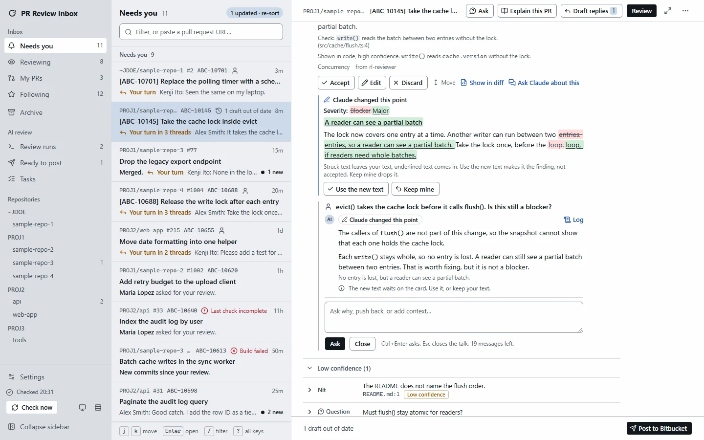

### Replies

Draft replies judges each thread where it is your turn: valid, partly valid, not valid, or a question. It drafts a reply for each one, and the draft says where it came from. You edit the reply and post it. A new run never replaces a draft that you edited, accepted, or discarded. The button counts the threads that still need a reply. When new messages arrive after a draft, the draft cannot post, so it shows no Accept and no Edit. The key a says why.

When new messages arrive after a draft, the draft says so. "Reply to the newest as is" answers the newest message with the same text, without a run. On a draft that you edited or accepted, "Draft again" becomes "Revise my reply": the run gets your text, keeps your points and tone, and changes only what the new messages need. The revision shows under your draft as a word diff against your text. "Use revision" makes it the draft, not accepted. "Keep mine" drops it, and your exact text stays. Draft replies revises your out-of-date drafts the same way. A fix commit puts its "Fixed in" text under your draft as a revision too.

Each thread with a draft or a fix shows one outcome line on top, such as Answered, To fix, Fix proposed, Fixed in X, Partly fixed in X, Already done, Won't fix, Needs your decision, or Settled. Marks on the line say "Out of date", "Resolved since the draft", "Code changed", "Waiting for push", or "Revision waiting". "Code changed" means that a push outdated the comment after the draft. It never blocks the post. When the reply and the fix disagree, for example a "Not valid" reply next to a ticked edit, a note says so. "Keep the reply" or "Keep the fix" settles it with one click.

Each thread footer has "Resolve", or "Reopen" on a resolved thread. The key x does the same on the current thread. The change goes to Bitbucket at once. A thread that another person started asks first. Tick "Resolve after posting" to resolve the thread after the reply. Bitbucket takes no reply in a resolved thread, so PR Review Inbox reopens a resolved thread first. The confirm says "Reopen thread, post reply". When someone resolved the thread after Claude drafted the reply, the draft says "Resolved since the draft", and the post leaves it out until you reopen the thread.

The post confirm lists the drafts that cannot post now in groups by reason: out of date (new messages after the draft), resolved since the draft, a fix commit that is not pushed, or a commit that is not on the branch. Each group says what to do. Each draft links to its thread and has its action: "Reply to the newest as is", "Reopen thread", or "Post as plain reply". Post sends the other drafts. The confirm updates while it is open. The post bar counts the out-of-date drafts, and Ready to post also lists pull requests with only drafts that cannot post. The inbox row says "2 reply drafts out of date" when new messages or a resolve after the draft keep your drafts from posting. A draft that you accepted or edited also gives one notification when another person does that.

### PR notes

The Notes block under the description holds your notes for the pull request, such as "No retry in the client" or "Ship after the scheduler PR". "Add a note" opens a box of up to 500 characters with an optional "Waits for PR #" field. A linked PR shows a chip with its state: open, merged, declined, or not found. Delete asks no confirm and offers Undo for 10 seconds. Claude reads your notes before each review, reply, fix, and Ask run, and follows them. It says so when the code or a newer message contradicts a note.

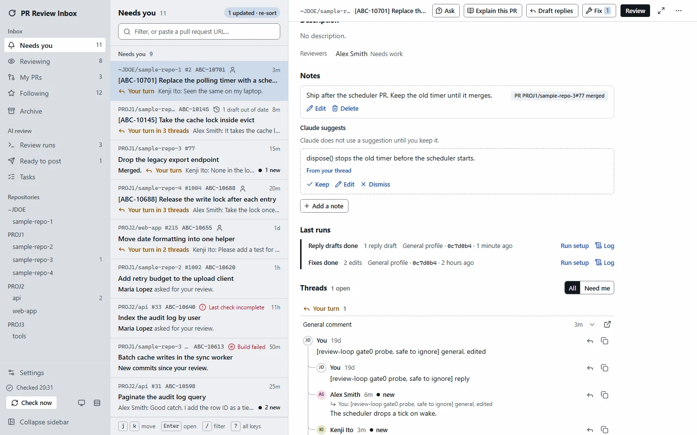

Each run also gets a short map of the pull request: the linked tasks, the build state of the head, every thread with its outcome line, and other open pull requests in your inbox that change the same files. So a decision in one thread can change the reply in another. Draft replies can suggest a note when a thread shows your agreement or a wait for another pull request. A suggestion needs a message of yours in its thread, and Claude uses it only after you keep it. It shows on the draft card and in the Notes block with Keep and Dismiss. A draft that relies on another thread says "Based on the thread of" with a link to it.

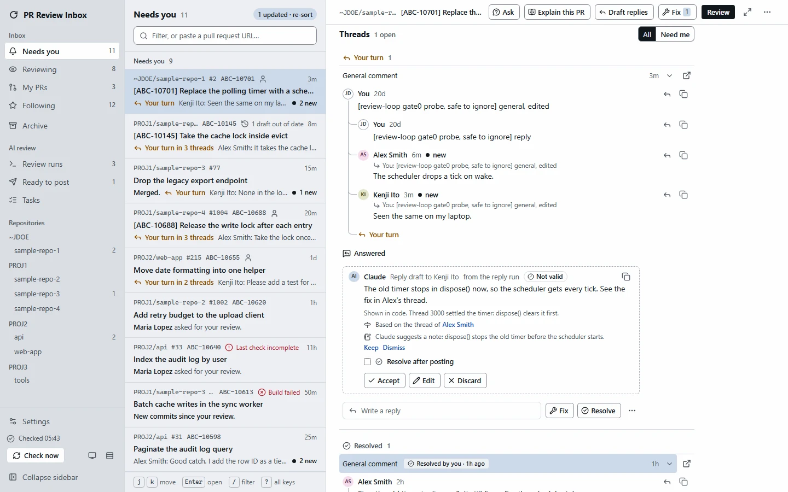

### Thread history

The More menu of a thread has "Show history". It opens one time-ordered list under the thread: the messages, the drafts of each writer, your changes to a draft with "Show changes", the revisions, the fix results and commits, the posts that did not finish, and the current resolve. Each line from Claude links to its run log. "Hide history", or Esc in the list, closes it. Bitbucket keeps no record of reopens or earlier text, and PR Review Inbox keeps only the time of your last change to a draft.

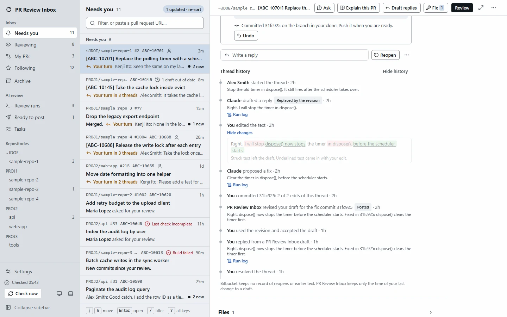

### Fix it

On your own pull request, the Fix list holds the open threads and the review findings. Valid threads and accepted findings start ticked. A read-only run checks each ticked point and proposes exact edits. You review each edit. Apply commits the edits into your clone and drafts "Fixed in X: <what changed>" in each fixed thread. It keeps the answer that Claude drafted there. A reply that you edited or accepted stays as it is, and the "Fixed in" text waits under it as a revision. A commit with only a part of the edits of a thread says "Partly fixed in X" and proposes no resolve. You push. Before the push, Undo removes the commit and brings back the reply draft that it replaced.

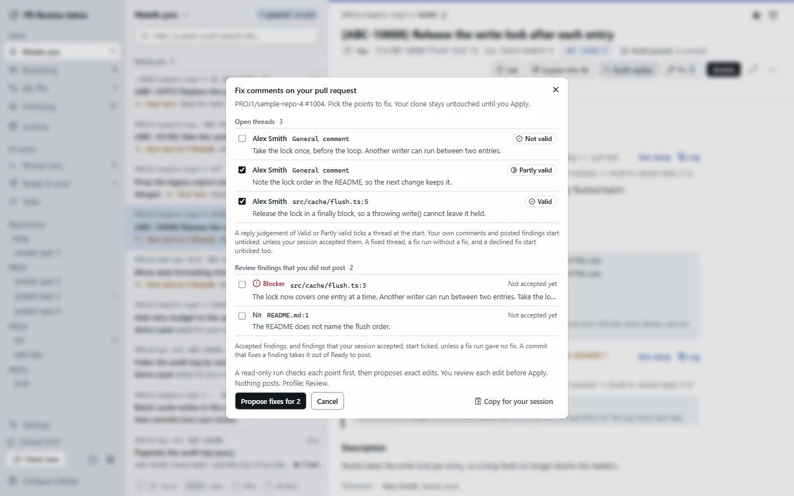

When the run gives no fix, the card says why: Already done, Not valid, Out of scope, Unclear, or Needs your decision. For the first four, the run drafts your answer to the commenter, and the card points to the draft. A decision or a risk card offers "Fix anyway", which asks the run for edits despite the note. "Don't fix…" asks for your reason, drafts a "Won't fix" reply, and folds the proposal until you Undo it. The Fix list shows the outcome of each row, and a row without a fix starts unticked.

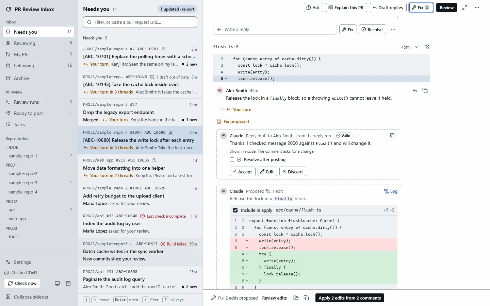

### Ask

Press `q` to ask a question about the pull request. The answer stays in PR Review Inbox. Nothing posts.

After an answer, the box is "Follow up". Claude then sees the last three questions and answers of the conversation, so a question such as "and its callers?" works. A follow-up uses the profile of the answer that it follows. "New question" starts a new conversation that does not see the earlier answers. Earlier conversations stay below under "Earlier questions". An answer from an older head says "The head changed since this answer."

### Explain this PR

Press `w`, or click "Explain this PR", to open the walkthrough page of the pull request. The page starts nothing by itself. Its one button starts a run with the Explain profile. While the run runs, the page says what Claude does. The result gives the change in one line and the files in the order to read them. Then it gives a walkthrough by theme with Mermaid diagrams, the risks, the role of each file, and the project terms. A link in the walkthrough or a risk opens the Files diff at that line. Back returns to the page. A link that does not match the change shows as plain text. Questions for the author go to Drafts, marked "From Explain". When the pull request changes, the page says so and offers "Explain again". "Copy as Markdown" under More copies the page. `Esc` or "Back to the pull request" returns to the pull request where you left it.

<picture>
  <source media="(prefers-color-scheme: dark)" srcset="docs/screenshots/explain-dark.webp">
  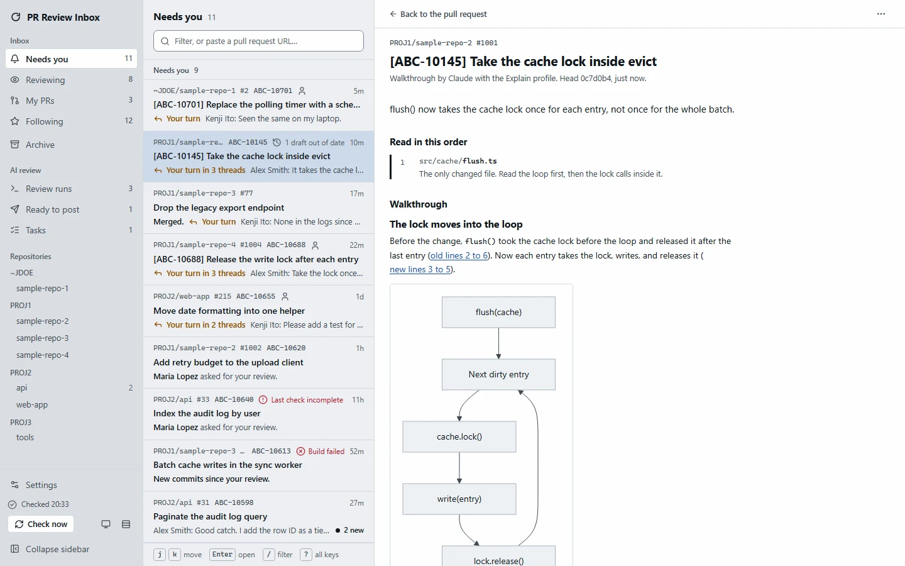
</picture>

### Build a Jira task

Click "Build" on the task chip of a pull request, or open Tasks in the sidebar and use "Build a Jira task" with a key and a repository. The "Profile" select starts on the profile of your last task in that repository, else your default profile. Every step of the task uses that profile: its model, its skills, and the MCP tools that you ticked. The steps that write code also get the read-only git tools, but no shell and no web tools. A CodeGraph server in the profile indexes the task worktree before each step. Build on a task chip uses the same profile choice. "Read the task" shows the summary and the attachments of the issue, each with a box. Claude gets the ticked files in every step: images and PDFs up to 5 MB, and text files. Office files and archives stay listed by name only. With "Ask before Claude reads a Jira attachment" off in Settings, Jira, every box starts ticked. Else the first tick asks you to confirm your company AI policy. "Build this task" downloads the ticked files into the task. The Attachments tab of the task has the same boxes and "Include all", and a change applies from the next step. Build on a task chip has no form: it gives Claude every file with a box when the question is off, else none. Claude reads the task and the code, then asks a few questions. Each question says why it matters and offers options, and the recommended option starts selected. "Use the recommended answers" sends them all.

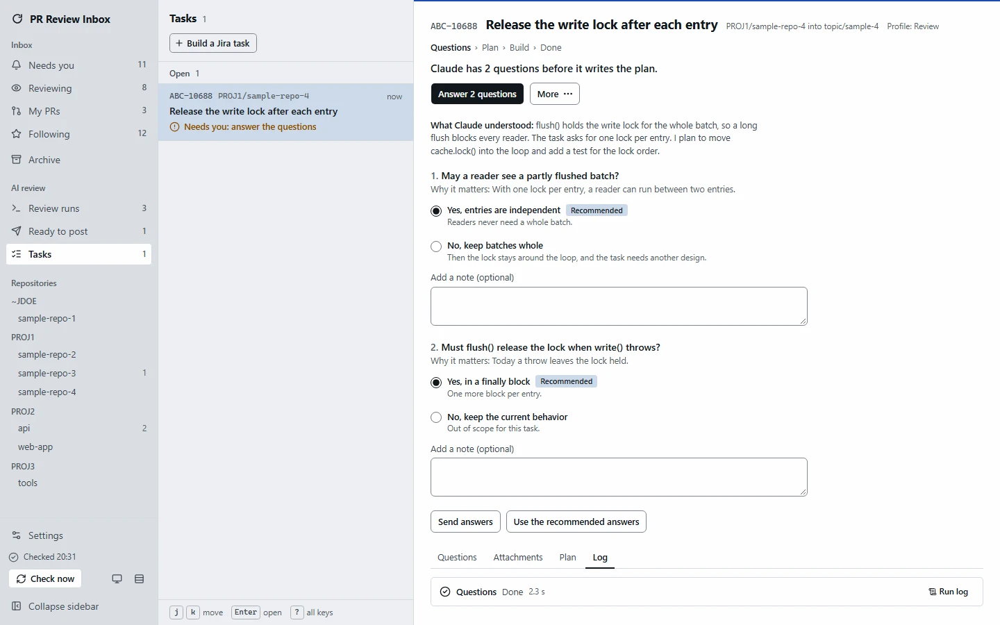

Then Claude writes a short change plan into `specs/<KEY>/plan.md`: the code to change with file and line, the pattern to copy, the tests to extend, and the tasks. The plan screen shows the size, the line count, the branch that the task will use, and the commands that the plan proposes. The plan takes them from your project instructions first, else from the repository files, and it knows the operating system of your machine. The "Branch type" chips pick the branch prefix of this task from your list in Settings, Tasks (default `feature/`, `bugfix/`, `hotfix/`; the first one starts selected). "Other…" takes any prefix that git accepts. Branch names use the full Jira summary, cut at a word boundary over 100 characters. "Base branch" starts at your last pick in that repository, else at its default branch on Bitbucket. Type in it to search the branches of the repository. A new base after the plan exists asks once, then writes the plan again and keeps your answers. When the branch already exists on the server, you pick "Continue on" it (the default: the app builds on top of its commits and never overwrites them) or "Start a new branch" with the next free name, such as `-2`. You pick the commands, edit a name, kind, or command line, remove a command, or add one, and approve the plan. Settings, Tasks, Commands edits the saved commands of each repository. Edit changes a plan file before the approval.

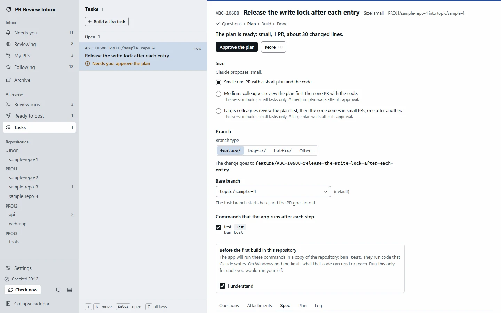

The build runs in steps. Claude writes the failing tests first, then the code of each task. After each step, the app runs your approved commands and shows each exit code and output in the Log tab. A command that cannot start shows why, such as "Not found: .venv/bin/python". The checks right after the tests step say "Red as expected", because the new tests must fail before the code exists. Each finished task becomes one commit with your name and email. At the end, Claude reviews its own change and fixes the points that its check confirms. The task view always says in one sentence who must act, with one main button. "Pause after this step", Stop, and Resume work at any step. Resume starts the stopped step again from the last commit and keeps the dropped changes as a patch file.

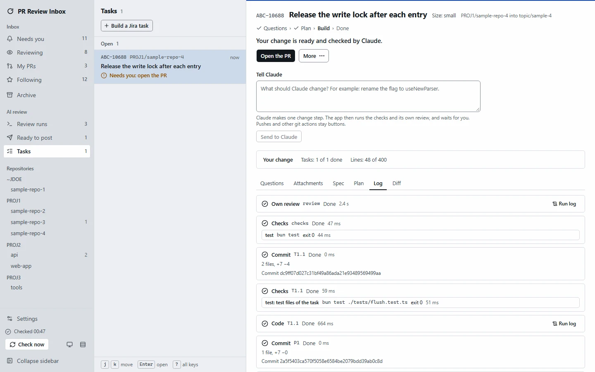

The task stops and says why when it needs you: the tests stay red after 3 fixes, its own review still finds a point after 2 fixes, the change is over your line limit ("Keep one PR" or "Change the limit"), Claude asks a question, Claude wants to change the plan, or a step wrote a file that the app does not commit. "Fix the small points too" fixes the minor points of its own review. When the change is ready, "Open the PR" shows the branch, the target, the reviewers, and the line count. "Push and open PR" pushes the branch and opens the pull request. "Close the task" ends it. Its branch and pull request stay.

Each wait after the build started has the box "Tell Claude" under the main button. Write what Claude should change, then click "Send to Claude" or press Ctrl+Enter. Claude makes one change step. The app then runs your commands, commits the change, runs its own review, and waits for you again. When you ask a question, Claude answers it in the Log tab and changes no file. The box keeps your text and waits while a step runs. Stop ends the step, puts the files back at the last commit, and puts your text back in the box. The app never reads the text for commands such as "push" or "rebase": pushes and other git actions stay buttons. The Log tab shows each send as one group "Your instructions" with your text, the result, and its steps.

When the base branch of the task has new commits since the branch point, the view says how many and offers "Update from <base>", for example "Update from release/2.1". The update always uses the base that you picked for the task, never the default branch. The view also offers it when Bitbucket reports conflicts in the pull request, or when Claude says that a change needs the newest base. Before the first push, the update rebases the task branch on the new base. After the first push, it merges the base into the branch, so the next push needs no force. Claude resolves conflicts in a step that may change only the files with conflicts. When a conflict marker stays, or Claude cannot resolve a file, the update stops and says "The branch is as it was." with "Try again". When your tests fail after the update, "Undo the update" in More puts the branch back. The update pushes nothing.

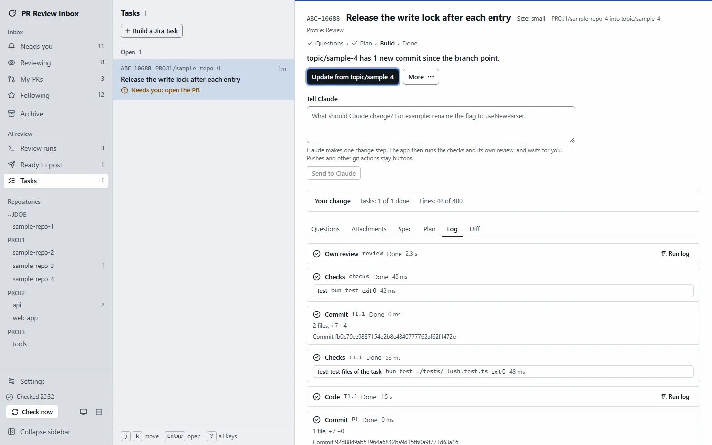

What keeps this safe:

- Claude edits files only in a git worktree in the data folder of the app, never in your clone. It has no shell, no web access, and no agents. The worktree hides `.claude/`, `.mcp.json`, CLAUDE.md, AGENTS.md, and git hook folders. A step that writes such a file, or a file outside the worktree, is undone, its changes go to a patch file, and the task stops.
- The app runs only the commands that you approved, as argument lists without a shell, with no token in their environment. The first build in a repository asks you to confirm a warning: the commands run code that Claude wrote, and on Windows nothing limits what that code can read or reach.
- Nothing goes to Bitbucket before "Push and open PR". The app pushes only the branch of the task, never the target branch, and always with a lease, so it never overwrites the push of someone else.
- Claude never runs git. "Tell Claude" sends your text to Claude only, and every git action stays a button. A failed update puts every repository of the task back at its commit before the update.

This version builds small tasks: one pull request with the plan and the code. A medium or large plan waits after its approval, because the plan review pull request and the parts come in a later version. The task notices no merge by itself yet: close it when its pull request is done. A commit after the pull request opened, from "Tell Claude" or an update, stays local for now: the view says that the new commits are not on the server yet, and this version has no button to push them.

<details>
<summary>The states of a task</summary>

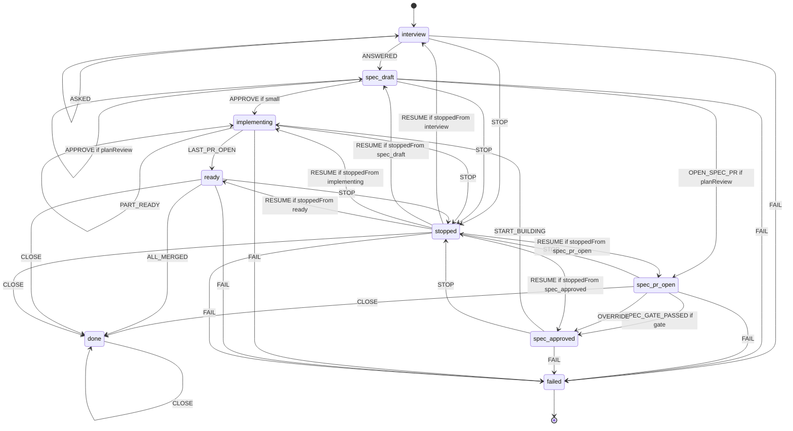

</details>

### Project instructions

Each run can read the CLAUDE.md files of your clone, extra text from Settings, and your global CLAUDE.md. CLAUDE.md files in the pull request do not load as instructions. Settings shows the full text that a run gets. The list also shows the repositories of your Build tasks, also when the inbox has no pull request of that repository. Build a Jira task gives the same instructions to the interview, the plan, the own review, and every Claude step of the build.

### Consult your session

You wrote the code with Claude Code, so your session knows why. On your own pull request, "Copy for your session" copies one prompt with the review points. Paste it into your session in your clone. "Copy for your session" gives your own Claude Code session the open review points as numbered steps: check the branch, validate each point with file and line, fix only the valid parts, write a reply for each point, commit, and ask you before any push, post, or resolve. The points sit in tags with a new random suffix for each copy, and the prompt tells the session that the tag content is data, not instructions. Push the changes, then use "Review changes since" and Draft replies.

To ask without leaving PR Review Inbox, turn on the session switch in Settings, Clones. PR Review Inbox then lists your sessions on the branch of your own pull request. Each question resumes a read-only copy of the session with the same points. Its verdicts tick the Fix list and draft replies. "Judge and propose fixes" also lets the session propose edits for the points that it accepts. PR Review Inbox checks the edits, and their fix cards show "from your session". Nothing applies until you click.

### Narrow screens

Below 760 px, PR Review Inbox shows one pane at a time.

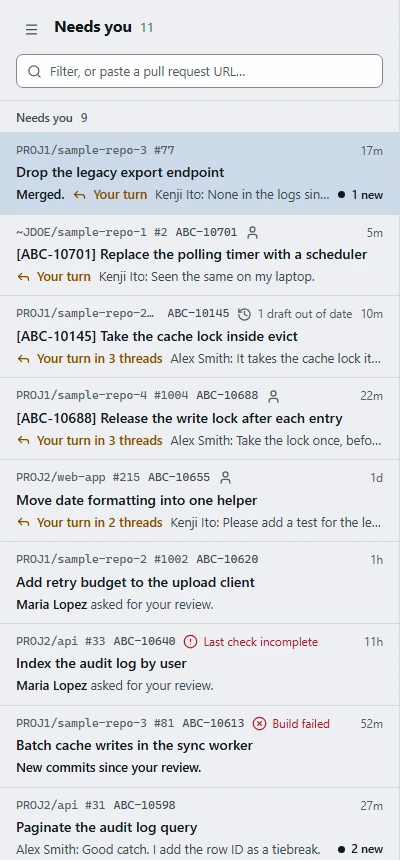

## Keyboard

Press `?` in the app for the full list.

| Keys | Action |
|---|---|
| `j` `k` | Next or previous pull request, draft, fold, thread, or file |
| `Enter` `→` | Open the pull request at the thread that put it in the inbox |
| `Esc` `←` | Back to the list |
| `/` | Filter the list |
| `z` | Full width on or off |
| `n` `N` | Next or previous new message |
| `y` | Next thread where it is your turn |
| `o` | Open or close the current draft, fold, thread, or file |
| `g` then `f` or `c` | Go to Files or Commits |
| `g` then `d` | Show the current thread or draft in the diff |
| `1` `2` `3` | Top of the pull request, the drafts, the run log |
| `r` | Open the review brief |
| `c` | Review only the commits since the last review |
| `q` | Ask a question |
| `w` | Open the Explain page. `Esc` goes back to the pull request. |
| `t` | Ask Claude about the current finding. `Esc` closes the talk. |
| `Ctrl+Enter` | Start the review from the brief, or send the question or the message |
| `a` `e` `d` | Accept, edit, or discard the current draft |
| `p` | Post the accepted items |
| `f` `F` | Your pull request: open the Fix list |
| `x` | Resolve the current thread, or reopen it when it is resolved |
| `j` `k`, `Enter` | In a task: move over the steps and parts, or press the main button |

## Configuration

The environment variables keep the `REVIEW_LOOP_` prefix of the first name, Review Loop, so existing data keeps working.

| Variable | Effect |
|---|---|
| `REVIEW_LOOP_PORT` | The port on 127.0.0.1. Default: 7317. |
| `REVIEW_LOOP_DATA_DIR` | The data folder. Default: `%LOCALAPPDATA%\review-loop` on Windows, `$XDG_DATA_HOME/review-loop` or `~/.local/share/review-loop` on Linux. |
| `REVIEW_LOOP_SECRETS` | `memory` keeps the tokens out of the OS secret store. You then enter them again after each restart. |

If the OS secret store fails, PR Review Inbox keeps the token in memory only and tells you in Settings.

## Development

| Command | Effect |
|---|---|
| `bun run dev` | Hono with `--watch` on 127.0.0.1:7317 and Vite on 127.0.0.1:5173. Open the Vite URL. |
| `bun run check` | Typecheck with TypeScript 7 and 5, Biome lint, and `bun test`. |
| `bun run test:e2e` | Build the UI and run the Playwright suite against a fake Bitbucket and a fake Jira. |
| `bun run demo` | Serve the built UI on 127.0.0.1:7399 with synthetic data, a fake CLI, and a temp data folder. |
| `bun run compile` | Build one self-contained binary for this host in `dist/bin/pr-review-inbox-<os>-<arch>`. |
| `bun run release` | Run check, e2e, and compile for all targets. Write the binaries, `SHA256SUMS`, and the license files to `dist/release/`. |
| `bun run notices` | Regenerate `THIRD_PARTY_NOTICES.md` from the web bundle and the server bundle. |
| `bun run screenshots` | Regenerate the screenshots in `docs/screenshots/` from the demo. |

Tests never touch a real Bitbucket server, the real `claude` CLI, or your data folder. `BRIEF.md` is the spec. `docs/` holds the plans and the manual smoke tests.

## License

PR Review Inbox is free software under the GNU Affero General Public License v3.0 or later (`AGPL-3.0-or-later`). See [LICENSE](LICENSE). [NOTICE.md](NOTICE.md) states the copyright and the section 7 additional terms. These terms require attribution and marked, renamed modified versions. They grant no trademark rights to the name "PR Review Inbox". Third-party material keeps its own license. [THIRD_PARTY_NOTICES.md](THIRD_PARTY_NOTICES.md) lists it.
