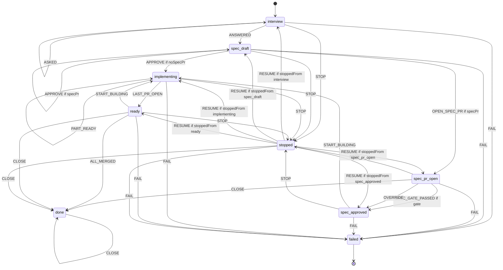
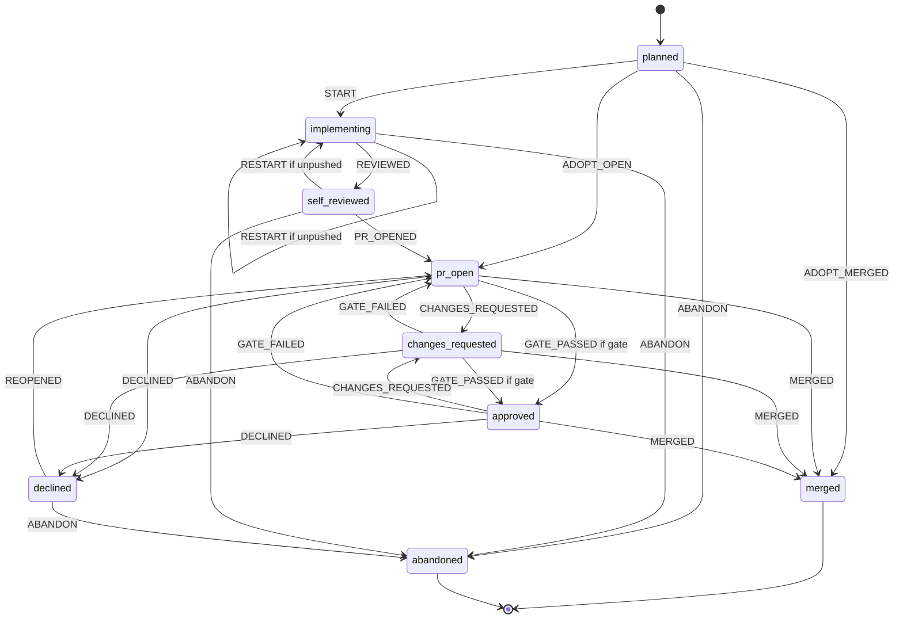

# Build a Jira task: one Claude session per part

Status: design of 2026-11-12 against main 31f8205 plus the uncommitted package WP-R1b. PS0 is code complete: the Gate B37 script (`scripts/gate/claude-checks.ts`, `scripts/gate/session.ts`) and CI12 (`scripts/gate/ci.ts`). Gate B37 and CI12 are not run. The other packages are not built. All user requirements of 2026-11-12 are decided. User answers of 2026-11-12: Q1 to Q9 take the recommended answers. Section 3 is approved, items 1 to 15, with the red-build fixes as a tick per part. RUN_TIME_MAX_MS (240 min) stays. This design replaces WP-R2 to WP-R5 and WP-R7 of build-redesign.md. It also replaces the per-step lead of agent-workflow.md option C. It folds in items 1 to 7 and 11 of build-redesign.md section 7.

Line numbers of loop.ts, implement.ts, stream.ts, context-files.ts, tasks.ts, and shared/task.ts are those of the WP-R1b tree. The other files are equal on main.

## Summary

- One Claude session builds one part. Claude writes the tests and the code. It runs the build and the tests through the existing shell modes, and it ticks the tasks in the plan file.
- The app runs the final checks before each commit. Red checks resume the session with the failure tail, at most "Test-fix tries" times.
- Follow-ups resume the same session: red checks, critic and review points, PR comments, red CI builds, your messages, and conflict help. A guard falls back to a fresh session with continue.md.
- The own review stays a fresh, separate run. A cheap Haiku critic runs once after the first commit of a build.
- The safety rules stay: the app-owned worktree, the full git deny, the path check, the git state check, the keep-work rule, and push only on a click. A denied path now undoes only its own files.
- Time limits go. A stall and loop guard stops a stuck run and keeps the work. A usage limit shows "Resume at <time>".
- Each resume fact waits for Gate B37. Until then, each follow-up starts a fresh session with continue.md. So the first packages need no gate.

## 1. Facts of today's code that change

### 1.1 The step chain of one part

- runPart (loop.ts:1705-1747) does these steps in order:
  - the plan commit;
  - setup (:1683-1703);
  - the baseline (:1244-1247);
  - a size check;
  - for each plan part, a tests step (:1321-1343) and one taskStep per open task (:1348-1362);
  - the final checks (:1735-1738), the own review (:1739), and REVIEWED (:1740-1745).
- taskStep runs one implement step (:1351). Then it runs the scoped checks with fix steps (greenOrFix :1252-1284), ticks the task (:1353-1357, tickTask :267-270), and makes one commit per task (:1358).
- The tests step may change only test files, and its new tests must fail (:1329-1339).
- The own review is a fresh review run on a sanitized snapshot (reviewRun :1366-1443). A confirmed blocker or major point starts a fix step, the checks, a commit, and a new review. This repeats at most REVIEW_FIX_TRIES = 2 times (:180, :1453-1477).
- "Fix these too" (drivePoints :1865-1884) starts one more fix step. Tell Claude (driveInstruct :2035-2071) starts one more instruct step.
- Each Claude step goes through runStep (:881-965), then startStep (implement.ts:857-1073), then implementSteps (jobs.ts:1465-1549), then run (claude.ts:586-703).

### 1.2 Session persistence and transcripts

- implementArgs passes `--no-session-persistence` (claude.ts:539). No task step keeps a session.
- The CLI still writes the per-cwd folders (Gate B4). The finally block of run() deletes them (claude.ts:700, removeCwdFolders :338-346).
- A run without the flag writes `<session id>.jsonl` into `~/.claude/projects/<encoded cwd>/` (integration-check.md:190).
- implementSteps deletes the run folder, with mcp.json, agents.json, and shell.json, after each run (jobs.ts:1536-1544).
- Only "Ask your session" resumes a session. It passes `--resume <abs .jsonl> --fork-session --no-session-persistence` and gets the read tools only (resumeArgs claude.ts:459-488).
- Verified on resume:
  - the original file stays unchanged (U47);
  - `--tools`, `--restricted`, and `--strict-mcp-config` apply, for read tools (U48);
  - `--json-schema` works (U49);
  - a fork without `--no-session-persistence` writes a new file with a new ID in the project folder of its cwd (U59).
- Not verified: Edit, Write, Bash, and the `--settings` rules on resume (build-redesign.md section 2.8).
- session-consult.md:19 says to always pass `--fork-session`. Without it, a running background session attaches, or the command exits with code 1.
- review_run keeps the session ID of each run (jobs.ts:1728).
- The fake CLI accepts `--resume` only with `--fork-session` (tests/support/fake-claude.ts:383-387).

### 1.3 Stop, kill, restart, and Continue

- Stop: loop.stop (loop.ts:2541-2570) calls review.cancelTask (jobs.ts:2445-2447), which ends every run of the task. cancel kills the process tree (claude.ts:706-711, killTree :304-335). after() still runs (jobs.ts:1546).
- The run end kills leftovers through the Job Object or the marker scan (claude.ts:691-699).
- Continue goes from loop.resume (loop.ts:2575-2634) to drive (:1821-1845) and settle (:1752-1761), then runs runPart again.
  - Records skip the steps that are done.
  - A cut step gets context/continue.md (continuation :833-876, continueFile context-files.ts:141).
- StepDetail.checked marks a step whose path check and git check passed, for any run end (implement.ts:1011; shared/task.ts:587).
- App restart: recoverTasks fails each open step and stops the task (tasks.ts:252-260). The git snapshot lives in memory only (gitstate.ts:25, :52-88). So the next Continue resets with a patch.
- A failed run stops the task with kind error (implement.ts:1030-1031, stopForRun tasks.ts:612-617). The usage limit takes the same path.

### 1.4 The stream parser and the init check

- createStreamParser (stream.ts:117-273) records each tool_use with its parent and ends it on its tool_result. It keeps the rl-main text and the agent reports as notes, up to NOTES_MAX = 200,000 (:47, :141-147).
- Init check: a tool in init.tools that is outside the allowed set goes to badTools (:221-226). The runner kills the run at once (claude.ts:642-646), and classify gives tool_check (stream.ts:300). Each process sends its own init event, so the check runs on a resume too.
- More than REFUSED_MAX = 5 refusals end the run (stream.ts:30; claude.ts:649-652).
- The parser keeps only a "rejected" flag from rate_limit_event (stream.ts:257-258). The type has resetsAt (run-log.ts:160-163), but no code reads it.
- The app type of an assistant message has no usage (run-log.ts:81-87). So the app cannot see the context size of a run.
- classify takes the last result that has structured_output (stream.ts:296). errorKind maps usage_limit, auth, max_turns, and schema (:283-291).

### 1.5 Limits that cut a part-sized run

- RUN_TIME_MAX_MS = 240 min caps every process, also with the step time off (shared/task.ts:119; claude.ts:613).
- STEP_TURNS: tests 60, implement 80, fix 40, instruct 80, resolve 40 (shared/task.ts:203).
- stdin is one Blob with the whole prompt (claude.ts:622), and run() waits for the process to exit (:673). No message can reach a running process.
- continueFile cuts the diff at FAILURE_TAIL = 32 KB (context-files.ts:141-155; shared/task.ts:214). This fits one step, not one part.
- One step takes one pool slot (jobs.ts:2464-2499; spec.md section 6.26).

### 1.6 Path check and undo

- pathCheck (implement.ts:137-192) and treeCheck (:208-271) list these problems: denied paths, hidden paths, unlisted CI configuration, links, nested repositories, files outside repo/, and changed ignored files.
- Any problem undoes the whole step. undoStep resets the worktree to the step start (:299-309). undoTrees resets every tree (:275-292).
- A changed ignored file removes the whole worktree (:285-288, :302-305).
- A git state change takes the same undo (:970, :973) and blocks with denied_path (:1027-1029).
- outsideRepo fails each changed file under context/ (:107-125). So Claude cannot tick the copy of the plan in context/spec/.
- The commit takes a new file only when a Write or an Edit named it (spec.md section 6.7, "New files of a commit").

### 1.7 PR comments, Tell Claude, and the PR Fix

- The task loop does not take PR comments as an instruct step. src/server/tasks holds no "comment" or "thread" code (search of 2026-11-12).
- Tell Claude sends only typed text, as one instruct step (spec.md sections 6.18.1 and 6.18.2; loop.ts:2035-2071).
- pushback.md:149 queues "PR threads into Tell Claude". spec.md:2949 only reserves section 6.23. pushback.md is not built.
- The PR Fix works on every own PR (jobs.ts:2329). It applies its edits in the user's clone (BRIEF.md:149-150, :174).
- The review code has no task PR check. So today a second writer on a task branch is possible.
- The reply run gives each thread a judgement: valid, partly, invalid, question, settled, unsettled, or followup (shared/review.ts:311-338). It has no group field.

### 1.8 CI builds and plan sizes

- Layer A reads the build status from Bitbucket (ci-builds.md:23-81). Layers B and C are on hold.
- The probe found one parameterized pipeline job, not a multibranch project (ci-builds.md:92-93; integration-check.md CI7).
- No probe check read a build log (integration-check.md CI1 to CI11).
- A small task gets plan.md. Medium and large tasks get design.md, spec.md, tasks.md, and a spec PR (plan.ts:642; spec.md section 6.1).
- The PR text comes from the plan (prText pr.ts:134-144).

## 2. Target design

### 2.1 Terms

- Part session: one Claude conversation that builds and fixes one part.
- Session run: one `claude -p` process of a part session. It takes one pool slot and one task_step row.
- Turn cap: `--max-turns` of one session run.
- Session heads: the HEAD of each edit worktree of the part at the last point where the app brought the session up to date.
- Fresh session: a new conversation that gets the full first prompt and context/continue.md.

### 2.2 Session lifecycle

**Start**

- The first build run of a part starts a fresh session. It uses implementArgs without `--no-session-persistence`.
- The runner gets `keep: {dir}`. Before removeCwdFolders (claude.ts:700), it moves `<projectsDir>/<encoded cwd>/<session id>.jsonl` into dir. The ID comes from init.session_id, and the file keeps its name.
- dir is `<taskDir>/sessions/part-<ord>/` (taskDir worktree.ts:67). It is outside the part folder (partDir :68), so the path check never sees it.
- task_part_session (section 5.3) stores these values: the session ID, the file name, its SHA-256, the session heads, the context size, and the run count.

**Runs**

- Each later run passes `--resume <absolute kept file> --fork-session`. It also passes every flag of its own run kind again (U48).
- The fork writes a new file with a new ID (U59). The keep step moves that file. The app stores it, then deletes the older file. So a part keeps one transcript.
- The original file stays unchanged (U47). So a failed resume loses nothing.
- The stdin of each resumed run starts with a short rules digest. Compaction can drop the first prompt, so the rules must come again.

**Guard: a run resumes only when all five rules hold**

1. The kept file exists, and its SHA-256 equals the stored value. Bash can write outside the cwd in Most commands and Unrestricted mode (SU9, SU19), and a transcript replays as trusted history.
2. The HEAD of each edit worktree equals its session head.
3. The context size of the last run is known and is at most "Session context cap". An unknown size counts as over the cap.
4. The last run of the session ended without a denied path and without a git state change. Such a run can carry a prompt injection in its context.
5. Gate B37 passed the facts that the run kind needs (section 4).

**What moves the session heads**

- The app commit after green checks. This commit holds only the work of the session, its ticks, and the plan files of the app.
- The line-end repair commit (matchBase, loop.ts:1137-1171). The next run gets the line "The app fixed the line endings of <n> files."
- The accept of a plan change that the session wrote.
- An update from the base branch whose conflicts a session run resolved (section 2.13).
- No other head move counts: not a clean update, "Get their commits", a pointer commit, or "Start this part again". After one of these, the next follow-up starts fresh.

**Fresh session**

- The run gets the full first prompt for its purpose and context/continue.md.
- continue.md (untrusted data) holds:
  - the subject lines of the part commits (base..head);
  - the diff stat;
  - the ticked tasks and the open tasks;
  - the summary and the notes of the last run;
  - the changed paths, when the worktree holds work.
- context/continue-diff.md holds the full diff since the last commit, cut at CONTINUE_DIFF_MAX = 2 MB. Claude reads it in parts. The FAILURE_TAIL cut stays for failure.md only.
- Some resumes fail before any tool event: no init, "No conversation found", or a process error. The app then starts one fresh session at once. The Log shows "The app could not resume the session. It started a new one with the earlier work."

**Cut runs**

- Stop, Hold, the stall guard, and the loop guard kill the process. The keep step still runs in the finally block.
- When U101 passes, the next run resumes the cut transcript. Else the app keeps the older stored file, and continue.md covers the cut run.
- The turn cap and the process cap (RUN_TIME_MAX_MS) continue once by themselves with "Continue where you stopped." (build-redesign.md Q2). A second cut waits for Continue.

**End and deletion**

- The app deletes the kept file and clears the session fields in these cases: the part PR merges or declines, the part is skipped, the user starts the part again, or the task closes or goes.
- So the transcript stays from the first build until the PR ends. PR comments and red builds can resume it.
- recoverTasks also deletes the per-cwd folders under projectsDir whose name starts with the encoded task root. A crash leaves such folders (BRIEF.md:445).
- After a restart, the stored transcript of the last finished run is the resume point. The next run gets the line "The last run stopped when the app stopped. Its changes are in the worktree. context/continue.md lists them."

### 2.3 What Claude is told

**First run of a session.** The stdin holds trusted app text, in this order:

1. Role: "You build part <k> of an approved plan in ./repo. You can change files only in ./repo. You post nothing. Git is denied. The app commits after its checks, and the user pushes." A task with several repositories adds the edit repositories of ./context/repos.md.
2. Plan: "./context/spec/ holds a read-only copy of the plan. Tick tasks only in <the tasks file of section 2.19>."
3. Work loop:
   - "Do the open tasks of ./context/step.md in plan order, one at a time."
   - "For each task, write or change its tests first. Run them and see them fail. Then change the code."
   - "Run the tests of the task. When its Done-when lines hold, change `### [ ] <id> ` to `### [x] <id> `. Tick only task headings. Change nothing else in the plan file."
4. Commands: the lines of the shell mode, as implementPrompt writes them today (implement.ts:391-415), plus one more line: "Write long command output to a file in ./scratch, and read its end with tail -n 200."
   - ./scratch is a folder of the part folder. The app empties it before each run.
   - The path check skips it (the skip list of outsideRepo, implement.ts:107-113).
5. Work rules (build-redesign.md section 7, item 3):
   - "Never skip, delete, or loosen a test to make it pass."
   - "Change a test only when the test is wrong. Say so in notes."
   - "./context/baseline.md lists the checks that fail on the part base. Do not fix them. Name such a failure in notes."
   - "Stop each background process that you started before you end the run."
6. Questions, allow requests, and plan changes: today's lines (implement.ts:356, :388-389, :441).
7. Result: "End the run when every open task is ticked and its tests pass, or when you need the user. Set done to true only then. List the IDs that you ticked in ticked."
8. The trust lines, the skills, the MCP lines, and the explorer rule, as today (:450-462).
9. The project instructions, and "Mode: build".

**Later runs (resume).** The stdin holds the rules digest, then "# Run <n>: <purpose>" and the lines of that purpose. The digest is about 10 lines: the folders, git denied, the trust lines, the tick rule, the result rule, and the untrusted-data rule.

| Purpose | Step row kind | Context files that the app writes | Lines |
|---|---|---|---|
| Continue after a cut | implement | continue.md when fresh | "The last run <ended at its turn cap, stopped, ...>. Go on from where you stopped." |
| Fix red checks | fix | failure.md (checkFailure, loop.ts:313) | "The app ran the checks. failure.md holds the output. Fix the cause." |
| Judge critic or review points | fix | failure.md with the points | pushback.md section 6.23.8 lines |
| PR comments | instruct | comments.md | pushback lines for comments, and "Give one entry in points for each thread." |
| Red CI build | fix | ci-log.md | "Find the cause in ci-log.md. Fix it when the code is at fault. When the cause is outside the code, change no file." |
| Your message | instruct | none | "Your instructions" holds the text (spec.md section 6.18.2) |
| Conflict help | resolve | conflicts.md | today's resolve lines (implement.ts:376-382) |
| Answer, allow choice, rejected plan change | the kind of the cut run | answers.md, step.md lines | today's lines |

implementResult (shared/task.ts:801-826) adds these fields:

- `ticked`: the task IDs, at most 30, default [].
- `points`: `[{id, verdict: fixed | pushback, why, reason, cite}]` (pushback.md section 6.23.2), default [].
- `ci`: `{cause: code | test | infra | unknown, quote} | null`, default null.

### 2.4 How the app learns progress

- Ticks: an ok Edit or Write event that targets the tasks file makes the app read that file from disk. The plan parser counts the ticked task headings of the part. The status line says "3 of 5 tasks done."
- Tick check at the run end: each changed plan file must equal its HEAD text, except `### [ ] <id> ` to `### [x] <id> ` for open task IDs of the part (the tickTask grammar, loop.ts:267-270). Any other change is a plan change, as today (loop.ts:1047-1056).
- `result.ticked` should equal the set of new ticks. A difference gives a Log note only.
- The Log shows the tool calls live (jobs.ts:1526-1529). The commands of the run go to detail.shell at the run end (implement.ts:953).
- Context size: the usage of the last main-thread assistant message, as input, cache-read, and cache-creation tokens (U105).
- Cost: implement.ts:1017-1021 adds the usage of each run to the part. U107 may show that a resumed run reports the totals of the whole session. If so, the app stores the session totals after each run and adds only the difference.

### 2.5 Path check and partial undo

The checks stay as they are. The undo touches only the problem paths. The app first saves a patch of those paths (savePatch with only, worktree.ts:389).

| Problem | Today | New |
|---|---|---|
| A tracked file at a denied, hidden, or unlisted CI path | The whole worktree goes back to the step start | `git checkout HEAD -- <path>` for that path only |
| A new file at such a path | git clean of everything | Delete that file only |
| A link | Remove the links, then reset | Remove that link only |
| A nested repository | Reset, then `clean -ffd` | Remove that folder only |
| A file outside repo/ | Remove it, then reset | Remove it only. ./scratch and the small card are skipped. |
| A changed file that git ignores | Remove the whole worktree | Delete those files only, and delete the setup mark, so setup runs before the next run |
| A change in a repository with access read or none | Reset every tree | Reset that repository only |
| The git link | Restore it, then reset | Restore it only |
| Git state (refs, cache config) | Restore it, then reset the worktree | Restore it, and keep the files (needs approval, section 3 item 3) |

- After the undo, the app runs the path check again. A problem that is still there takes the old full reset, with the patch.
- When the second check is clean, the run sets checked, and the other work stays.
- The part waits with "Needs you: Claude changed <path>, which a task may not change. The app undid that file and kept the other work." The primary button is Continue. The next run starts a fresh session (guard rule 4).

**Git snapshot on disk (build-redesign.md WP-R6)**

- Before each run, snapGit (gitstate.ts:52-88) writes `{files, refs, heads}` to `<taskDir>/part-<ord>.gitsnap.json`.
- After a restart, recoverTasks runs checkGit from that file. No app git call ran after the crash, so the missing watch changes nothing.
- A clean check keeps the work. So a restart no longer costs a whole part.

### 2.6 The final checks gate and the fix loop

1. A run ends with done true and with no reason.
2. The tick check and the path check have already run at the run end.
3. The app runs the build, test, and lint commands once (checks, loop.ts:1079). checksDone skips them when they were green at this head (:1125-1130).
4. Red: a fix run resumes the session with failure.md.
   - The red-before rule (:1263-1272) and the "changed no file" rule (:1280-1281) stay.
   - At most "Test-fix tries" runs follow (shared/task.ts:96, default 3). Then the part waits with "Needs you: the checks of part 2 stay red after 3 tries."
   - Continue gives 3 more tries, and the work stays.
5. Green: the app makes one commit with the user's name and email (commit, loop.ts:1209-1233).
   - Message: "<KEY>: <part title>", with the ticked task IDs in the body.
   - Later rounds use "<KEY>: Fix the review points of part 2", "<KEY>: Address the PR comments of part 2", or "<KEY>: Fix the build of part 2".
6. So each green gate gives one commit, and a half edit never reaches a commit unchecked.
7. The size check gives a note, not a stop (build-redesign.md Q1): "This PR has 520 changed lines, over your 400 limit." The note has a "Change the limit" link.
8. A run can end with done false, no question, no allow request, and no plan change. The part then waits with "Needs you: Claude ended the run before the part was done: <summary>. Continue resumes the session."
9. The baseline (loop.ts:1244-1247) runs once before the first run. context/baseline.md gives its red commands to Claude.
10. The tests-only rule of the tests step goes. A part that changed no path of the test globs gets this line on the ready screen: "Claude added or changed no test file." (DEFAULT_TEST_GLOBS, spec.md section 6.7).

### 2.7 The critic

- When: once, after the first commit of a build. It needs the committed base..head.
- Run: a task review run (review.taskRun, as reviewRun loop.ts:1366-1443) with item critic. It uses model haiku, no verify phase, no subagent, a fixed app prompt, the review finding schema, and 30 turns.
- Filter: validate (validate.ts) runs as for a review, with one more rule. The app keeps a finding only when each line of its anchor range is an added line of base..head.
- Kept points: one resume run judges them with the pushback lines. A push-back gets a Log line only. Then the gate of section 2.6 runs.
- No kept point: nothing runs. A failed critic gives a Log note and never stops the part.

### 2.8 The own review

- It stays a fresh, separate review run on the sanitized snapshot (reviewRun, loop.ts:1366-1443). It never resumes a session.
- Confirmed blocker and major points: a resume run of the part session judges them with the lines of pushback.md section 6.23.8.
  - Each push-back becomes a question (6.23.4).
  - Then the gate runs, and a new review follows, at most REVIEW_FIX_TRIES = 2 times (loop.ts:180).
- "Fix these too" sends the minor points to the session as one resume run.

### 2.9 Live messages

- The Tell Claude box (spec.md section 6.18.1) becomes the message box of the part. It shows in every state that has a worktree.
- While a run works, "Send" writes a stream-json user message to the stdin of that run (U104). The Log shows "Your message" with the time.
- While no run works, "Send" starts a run with the text as "Your instructions" (spec.md section 6.18.2).
- The text is user text. It can steer the work, but never the rules. The app never parses it.
- Runner: `--input-format stream-json`, with stdin as a pipe. The first message is the prompt. The runner closes stdin after a result event when no message waits.
- If U104 fails, a message sent during a run waits and goes into the next run as "Your instructions". The hint says "Claude reads this when the current run ends."

### 2.10 Stall and loop guard

- Stall: when no stream line comes for STALL_MS = 15 min and no tool call is open, the app ends the run.
- An open Bash call gets its own limit: the bash_timeout_sec of the repository plus 5 min (BASH_TIMEOUT_MAX_SEC = 3600, shared/task.ts:412). So the CLI ends a long command first.
- An open Agent call follows the normal rule, because its nested events keep the stream going.
- Loop: in one thread (one parent), the app counts consecutive calls with the same tool, the same input JSON, and the same result text.
  - At 3, it writes a Log note. With live input, it also sends "You made the same call 3 times with the same result. Change the approach, or set question and stop."
  - At 5, it ends the run.
- Both guards keep the work (the checked rule). The part waits with "Needs you: Claude sent nothing for 15 minutes. The app stopped the run and kept the work." The primary button is Continue.
- The settings "Task step time" and "Part time" go (shared/task.ts:92-93). RUN_TIME_MAX_MS stays as the cap of one process.

### 2.11 Usage limit

- The parser stores resetsAt from the last rate_limit_event with status rejected. Its unit is not verified (U106).
- The run ends with kind usage_limit (stream.ts:287). The part gets the new reason kind usage, with resumeAt. The task does not stop.
- Status: "Your Claude usage limit is reached. It resets at 14:30." The primary button is "Resume at 14:30".
  - A click before that time arms the resume. The status then says "Claude resumes at 14:30.", and More has "Cancel the resume".
  - A click after that time resumes at once.
  - When the CLI gives no reset time, the primary button is "Resume".
- The setting "Resume by itself after a usage limit" is off by default. When it is on, the app arms the resume at once. It resumes once per limit. A second limit needs a click.
- task_part_session keeps resume_at and resume_armed. A restart arms the timer again.
- The BRIEF wording changes (section 3, item 2).

### 2.12 Hold, Skip, and start again

- **Hold** (More, per part): the app cancels the run of that part only, with a new cancel by the key prefix `task:<id>:part:<part>:`. Today's jobs.ts:2445-2447 cancels the whole task.
  - The work stays. The status says "Part 2 is on hold. Its work is kept." The primary button is Continue.
  - Hold replaces "Pause after this step" (loop.ts:2529-2538) and "Pause after each task" (:1360-1361).
- **Skip this part** (a task with sub-tasks, before the PR of the part): a confirm comes first. Then the app saves the patch, sends ABANDON (machine.ts:109-110), removes the worktree, and deletes the transcript.
- **Start this part again** (before the first push only):
  - The confirm says "Claude starts part 2 again from the plan. The app keeps the old work as a patch and as a backup branch in the app cache. Nothing goes to Bitbucket."
  - The app saves the patch and writes `refs/rl/<task>/backup/part-<ord>-<n>` at the old head.
  - It resets the part branch to its plan commit, deletes the transcript, and clears the reason. The baseline and the setup mark stay.
- After the first push, "Start this part again" does not show. The app never force-pushes after the first push (BRIEF.md:175).

### 2.13 Update from the base branch

- The update stays app git (spec.md section 6.18.3). The push stays a click.
- At a conflict stop, the resolve run resumes the part session when the guard held at the update start. Else it is a fresh resolve run, as today.
- A resolve run keeps its limits:
  - no Bash (BRIEF.md:157; U99);
  - the path check on the unmerged paths (implement.ts:964-965);
  - the marker check;
  - RESOLVE_STOPS.
- An update with a session resolve moves the session heads. A clean update does not, so the next follow-up starts fresh.
- needsBase (spec.md section 6.18.2) stays.

### 2.14 PR comments on a task PR

1. A task PR with your-turn threads shows "3 comments on the PR of part 2." The primary button is "Sort the comments".
2. The click starts the existing reply run (draftReplies, jobs.ts:2292).
   - The run adds the plan and answers.md to context/task.md (pushback.md section 6.23.7).
   - replyDraft (shared/review.ts:314-338) adds `group`: threads with one cause share a number. The default null keeps old drafts valid.
3. The Task view lists the groups. Each group shows its threads, the judgement, the draft reply, and a choice:
   - Fix is the default for valid and partly.
   - Push back is the default for invalid.
   - A question thread gets Reply only.
4. The primary button "Send 2 groups to Claude" starts one instruct run of the part session.
   - context/comments.md is untrusted text that the app writes: each picked thread with its path, line, and messages, by group.
   - The result gives `points` for each thread: fixed, or pushback with a reason.
5. Then the gate of section 2.6, a commit, and the own review follow, as driveInstruct does today (loop.ts:2057-2066).
6. Drafts:
   - A fixed thread gets "Fixed in <short commit>: <what>" (BRIEF.md:535).
   - A thread that Claude pushed back on gets Claude's reason as its draft.
   - The user edits and accepts the drafts as today.
7. Out: one confirm "Push to <branch> and post 3 replies". It shows the branch, the commits, and each reply text.
   - The push goes first. Then the accepted drafts go out through the outbox.
   - A "Fixed in" reply never posts before its commit is pushed.
8. On a task PR, the PR-view Fix button opens this flow. The clone Apply refuses a task branch. This closes the second-writer gap of section 1.7.

### 2.15 Red Jenkins builds (refresh of ci-builds.md Layer C)

**Package C1, no token**

- The build-failed row (spec.md section 6.12) gets the primary button "Let Claude fix the build". It opens the box "Paste the end of the build log".
- The text goes to context/ci-log.md as untrusted data, cut to OUTPUT_TAIL = 64 KB (shared/task.ts:213).
- A fix run of the part session reads it. The result field `ci` gives the cause and one quote. The app checks that the quote is in ci-log.md.
- Cause infra or unknown, and no change: the status says "Claude says the build failed outside the code: <quote>." The primary button is "Go to the build".
- Cause code or test: the gate of section 2.6 runs, then a commit, then "Push to <branch>" (a click).

**Package C2, Jenkins token**

- Settings gets the Jenkins card of ci-builds.md:104-109: the base URL, the user, the CA file, and the token in the OS store under jenkins-token. Save checks whoAmI.
- The app reads the log with GET `<build URL>logText/progressiveText?start=<X-Text-Size − 2 MB>` (ci-builds.md:141).
  - It reads only when the origin of the status URL equals the configured origin.
  - It follows no redirect.
  - The new gate:ci fact CI12 checks this read.
- A run never gets the token and never calls Jenkins.

**Red-build fixes** (needs C2 and the hard-rule change)

- The push confirm of a part gets a checkbox: "When the build of this push fails, let Claude fix it and push the fix, up to [2] times. These pushes go to the PR without your look at the diff."
- Scope: this part branch only, from this push on.
- N: the number in the box. The setting "Red-build fixes" gives the default (2; range 1 to 5).
- Each automatic push uses the normal push path (push.ts:51-70): the explicit lease of the last pushed commit, the fast-forward check, no force, no `+`, and only task_part.branch.
- Each automatic push comes after green checks and after an own review with no must-fix point. It posts no reply, changes no PR text, and moves nothing in Jira.
- The mode ends when one of these occurs:
  - N pushes are used;
  - a build passes on the pushed head;
  - Claude gives cause infra or unknown;
  - any Needs you reason comes;
  - a push fails;
  - the user clicks "Stop red-build fixes";
  - the PR merges or declines;
  - no build status shows for the pushed head within BUILD_WAIT = 60 min.
- The last rule covers a job that a push does not start. That job behavior is not verified (ci-builds.md:92-93, :181).
- Each automatic push gives the notification "Claude pushed a fix for the red build of part 2 (1 of 2)." The Log shows the push row.
- task_part_session keeps ci_fix_left and ci_fix_max. "Start this part again" clears them.

### 2.16 Agent workflows

- The main thread of the part session is the lead of agent-workflow.md. It can use the pinned workflow of the task (task.workflow_json).
- Build, fix, and message runs use the workflow. Resolve runs, the critic, and the own review never use it.
- Agents that write files or run commands still wait for Gate B36. B37 adds one check: a resume keeps the limits of the agents file (U108).
- agent-workflow.md rejected option B for four reasons. This design answers each one:
  - the app runs the checks before each commit, so spec.md section 6.21.7 holds;
  - the path check and the git check run after each run;
  - a denied path undoes only its own files;
  - each run takes its own slot.

### 2.17 UI states

Each state has one primary button or none.

| State | Status sentence | Primary | More |
|---|---|---|---|
| Building | "Claude builds part 2: 3 of 5 tasks done." | none (message box) | Hold, Stop |
| Checking | "The app runs the checks of part 2." | none | Stop |
| Fixing | "Claude fixes the checks of part 2 (try 1 of 3)." | none (message box) | Hold, Stop |
| Critic or review | "A second Claude run reviews part 2." | none | Stop |
| Ready | "Part 2 is ready: 5 tasks, 340 lines, checks green." | "Open PR for part 2" | Show the diff, Fix these too, Start this part again |
| Claude asks | "Claude asks: <question>" | "Answer" | Use the recommended answers, Stop |
| Claude asks to run a command | "Claude asks to run a command." | "Continue" | Stop |
| Plan change | "Claude proposes a change to the plan." | "Review the change" | Reject, Stop |
| Needs you | "<cause>. Continue <what it does>." | "Continue" | options, See why, Stop |
| Usage limit | "Your Claude usage limit is reached. It resets at 14:30." | "Resume at 14:30" | Stop |
| Resume armed | "Claude resumes at 14:30." | none | Cancel the resume, Stop |
| On hold | "Part 2 is on hold. Its work is kept." | "Continue" | Skip this part, Start this part again |
| PR comments | "3 comments on the PR of part 2." | "Sort the comments" | Go to the PR |
| Comments sorted | "2 groups to fix, 1 to push back." | "Send 2 groups to Claude" | Post the replies only, Go to the PR |
| Fixed, not pushed | "Part 2 has 1 new commit. 3 replies wait." | "Push and post 3 replies" | Show the diff |
| Build failed | "The build of your PR failed: <name>." | "Let Claude fix the build" | Go to the PR |
| Red-build fixes on | "Claude fixes red builds of part 2 by itself (1 of 2 used)." | none | Stop red-build fixes, Go to the PR |
| Stopped | "Stopped at part 2. The work is kept." | "Continue" | Start this part again, Close the task |

- Every Needs you box uses Continue (build-redesign.md section 2.5). Stop stays in More.
- The Plan tab shows the tick progress of each part.
- The Log tab groups the runs of one session under "Claude session of part 2". Each run shows "resumed" or "new session".

### 2.18 Settings

Settings > Tasks > Run limits:

- "Test-fix tries" stays (1 to 10, default 3). It caps the fix runs of one gate.
- New: "Session context cap", 20,000 to 500,000 tokens, default 100,000 (question Q2).
- New: "Session run turns", 50 to 1,000, default 500. 1,000 is the profile bound (BRIEF.md:447).
- New: "Red-build fixes", 1 to 5, default 2.
- New: the switch "Resume by itself after a usage limit", off by default.
- "Task step time" and "Part time" go. The app ignores an old config value.

### 2.19 Spec size levels (build-redesign.md section 7, item 4)

| Size | Plan | Tasks file that Claude ticks | Spec PR | PR description |
|---|---|---|---|---|
| Small | A task card: goal, acceptance, tests, and tasks | ./card.md in the part folder. It is outside repo/ and never committed. The path check skips it. | no | The card (prText, pr.ts:134-144) |
| Medium | One short brief | repo/<spec dir>/brief.md, committed with the code | no (question Q9) | Goal and acceptance from the brief |
| Large | The full spec: design.md, spec.md, tasks.md | repo/<spec dir>/tasks.md | yes | As today |

- docNames (plan.ts:642) and the spec run prompt change per size.
- Medium leaves the spec PR states of the task machine (machine.ts:72-81).

## 3. Hard rules: wording for approval

Each item gives the line now and the new wording.

1. **BRIEF.md:237, principle 1.** Now: "Human gate: nothing goes to the code host without an explicit user action." Add: "One tick in the push confirm of a task part allows up to N pushes of red-build fixes for that part only (spec.md section 6.28)."
2. **BRIEF.md:241, principle 5.** Now: "No automatic retry after a usage limit. A task loop takes a run slot for each Claude step and frees it between steps." New: "No automatic retry after a usage limit, except the setting 'Resume by itself after a usage limit', which is off by default. With it, a part session of a task resumes once at the reset time that the CLI reports. A task loop takes a run slot for each run of a part session and frees it between runs."
3. **BRIEF.md:156, git state.** Now: "On a change, it restores them, saves the patch, resets the worktree to the step start, and waits". New: "On a change, it restores them, saves the patch, keeps the files that pass the path check, and waits with 'Needs you: Claude changed git state during the run. The app restored it.' The next run starts a new session." (Recommended; question Q4.)
4. **BRIEF.md:155.** Now: "After each Claude step, the app runs git status. A denied path (Denied paths, section 7), a link, or a path outside repo/ fails the step. The app saves the changes as a patch, then resets the worktree to the last commit." New: "After each run of a part session, the app runs git status. A denied path, a link, or a path outside repo/ fails the run. The app saves a patch of those paths and undoes only them. The other work stays. A problem that the undo cannot clear resets the worktree to the last commit."
5. **BRIEF.md:157.** Now: "The tests, implement, fix, and instruct steps also get the Bash tool when". New: "The build, fix, and message runs of a part session also get the Bash tool when". Then: "The interview, spec, resolve, critic, and own review runs never get it."
6. **BRIEF.md:162.** After "the user's look at each PR before the push", add: ", except the red-build fixes that the user ticked for a part".
7. **BRIEF.md:175.** After "go to Bitbucket only on a click", add: "One exception: the red-build fixes that the user ticked in the push confirm of a part. They push at most N fast-forward fix commits to that part branch. Each push follows green app checks and keeps the lease rules."
8. **BRIEF 3.6, new bullet (C2):** "Outbound calls can also go to the configured Jenkins origin. They occur on a Settings save or Test, and on a log read of a failed build of a task PR. The read follows 'Let Claude fix the build', or comes within the red-build fixes. The client sends GET only and uses https, except on localhost. It follows no redirect and calls no other origin. The Jenkins token uses the OS store under its own name."
   - BRIEF 3.5, new bullet: "A run never gets the CI token or calls the CI server."
9. **BRIEF.md:288-289, US10.** Now: "The tool then writes tests and code step by step, runs my approved build and test commands, and reviews its own work." and "A pull request that grows past the line budget stops and proposes a split. A stopped task resumes from its last good step."
   - New: "The tool then writes tests and code in one Claude session per part, runs my approved build and test commands before each commit, and reviews its own work. Small: one pull request whose description is the task card. Medium: one pull request with a short brief and the code."
   - New: "A pull request over the line budget shows a note with the count. A stopped task goes on from where it stopped and keeps its work."
10. **BRIEF.md:429, flags.** Add: "From its second run on, a part session run of a task drops --no-session-persistence and adds --resume <transcript> --fork-session (spec.md section 6.28)."
11. **BRIEF.md:444-445.** Now: "App runs never resume a session. ... Only 'Ask your session' ... resumes a session". New:
    - "PR runs never resume a session. Two features resume one."
    - "'Ask your session' forks the user's own session with --fork-session and --no-session-persistence."
    - "A part session of a task forks its own newest transcript with --fork-session."
    - "The app moves each transcript of a part session into the task folder, outside the run folder."
    - "It checks the SHA-256 of the transcript before each resume."
    - "It deletes the transcript in these cases: the part PR merges or declines, the part starts again or is skipped, or the task closes."
12. **BRIEF.md:462, History bullet.** "No run resumes a session." becomes "No PR run resumes a session."
13. **BRIEF.md:493, task loop.** New:
    - "Task loop of one part: one Claude session writes tests and code for the open tasks."
    - "It runs the build and the tests through its shell mode, and it ticks each task in the plan file."
    - "The app runs the approved checks before each commit. Red checks resume the session, at most 'Test-fix tries' times."
    - "A cheap critic and the own review (finder and verify phase) follow. Confirmed points resume the session, at most 2 review rounds."
    - "A part over the line budget shows a note. Then the part waits for its PR click."
    - "Each stop says why and offers one button. Continue goes on from where the build stopped and keeps the work."
    - "'Start this part again' resets the part before its first push. It keeps the old work as a patch and a backup branch."
14. **CLAUDE.md, Hard rules.**
    - "Nothing goes to Bitbucket or Jira without an explicit user action. The app posts, not the AI." becomes "Nothing goes to Bitbucket, Jira, or Jenkins without an explicit user action. The app posts, not the AI. The red-build fixes of a task part are one explicit action for at most N pushes (spec.md section 6.28)."
    - "The Bitbucket token never goes into SQLite, localStorage, logs, URLs, or prompts." becomes "The Bitbucket, Jira, and Jenkins tokens never go into SQLite, localStorage, logs, URLs, or prompts."
    - In the Build a Jira task exception, "A push and a PR create or update go to Bitbucket only on the user's click." becomes "... only on the user's click, or within the red-build fixes that the user ticked for that part."
15. **BRIEF section 7, layout.** Add `src/server/ci/`, with all Jenkins calls in `src/server/ci/jenkins.ts` (ci-builds.md:135).

## 4. Gate B37

Numbers: B36 and U96 are the last numbers in use (agent-workflow.md section 6). B37 takes U97 to U111. The gate:ci probe gets CI12.

How to run it:

- Run `bun scripts/gate/claude-checks.ts --only B37`, then `bun scripts/gate/sanitize-claude.ts`. The sanitizer must print `hits=0`.
- The gate uses haiku and makes at most 9 calls (8 planned). Only U109 uses sonnet.
- It uses a temp part folder with repo/ (a temp git repository), context/, and an app folder. The app folder holds the app's implementArgs, shell.json (an allowlist with the probe pattern and `sleep *`, because U101 and U104 wait in a sleep), shellEnv, and agents.json (rl-main and rl-explorer).
- Runs 2 to 4 resume the moved run 1 file, so one failed run costs only its own facts.
- CI12: `bun run gate:ci -- <PR URL> --jenkins <Jenkins URL> --jenkins-user <user> --build <build URL>`. The build URL comes from `--build`, because the CI3 status URL shape (`/<s>/<s>/job/<s>/<s>`) is not verified as a build URL (integration-check.md CI3). So CI12 does not show how the app gets from a status URL to a build URL. PS7b needs that fact.

| Fact | Check | PASS | If it fails |
|---|---|---|---|
| U97. Resume with the implement flags | `--resume <abs> --fork-session` with `--restricted`, `--tools Read,Grep,Glob,Edit,Write,Bash,Agent`, `--settings`, `--agents`, `--agent rl-main`, `--json-schema`, `--max-turns`, and no `--no-session-persistence` | Exit 0. init.tools equals the flags. permissionMode is default. structured_output parses as implementResult. | No run resumes. Every follow-up starts fresh. |
| U98. Limits after a resume | The resumed run tries a Write to ../outside.txt, `git status`, an unlisted command, and `<probe> && git status` | Each one is refused with the app label. The probe pattern runs. | Shell runs never resume. |
| U99. Fewer tools on a resume | A resume without Bash and Agent (a resolve run) | init lists no Bash. A Bash call never runs. | Resolve runs start fresh. |
| U100. New head | Between the runs, the gate commits a change of a.txt and edits b.txt on disk. The resumed run reads both and edits a.txt. | The run sees the new text. INFO: is an Edit of a file read in run 1, with no new Read, refused as "modified since read"? | Only app commits of the session's own work move the session heads. Drop the line-end note rule. |
| U101. Resume after a kill | The gate kills the CLI after the first Write event of a run that sleeps in Bash, then resumes the moved partial transcript | Exit 0. The run knows the Write. | After a kill, resume the older stored file, and add the continue.md line. |
| U102. Process cap | The same kill path as U101 (claude.ts:635-638) | INFO only. | As U101. |
| U103. Transcript place | Without `--no-session-persistence`: the new file is `<projectsDir>/<encoded cwd>/<id>.jsonl`. List the subagent and memory files. Resume from the moved file in another folder. | All hold. The moved file keeps its name. | When a moved file cannot resume, copy it back before each resume. Else no run resumes. |
| U104. stream-json input | `--input-format stream-json` with the implement flags. While the run waits in `sleep 20`, the gate writes a second message that asks for a marker file. | The marker exists. The result has structured_output. The CLI exits after stdin closes. INFO: does the CLI wait for stdin after a result? | A message waits for the next run (section 2.9). |
| U105. Context size | Each main-thread assistant event carries message.usage with input, cache-read, and cache-creation tokens | Present on each such event. | The size stays unknown, so each follow-up starts fresh. |
| U106. Rate limit fields | Record each rate_limit_event: status, resetsAt and its unit, rateLimitType | INFO. | Show "Resume" without a time. |
| U107. Usage of a resumed run | Compare total_cost_usd, usage, and modelUsage of the first run and the resumed run, and the cache-read tokens of the first call of the resumed run | INFO: per process, or the whole session. | The app subtracts the stored totals when the values are for the whole session. |
| U108. Agents on a resume | The resumed run asks for general-purpose and for rl-explorer | general-purpose is refused. rl-explorer runs read-only. | Resumed runs drop the Agent tool. |
| U109. Other model on a resume | A resume with another `--model` and `--effort` | Exit 0. init.model is the new model. | A profile change starts a fresh session. |
| U110. Critic run | `--model haiku` with the review flags, no verify phase, and reviewJsonSchema | structured_output parses. | The critic uses the reviewer model of the profile. |
| U111. Days later | Manual, in docs/smoke-task.md part P: resume a kept transcript after at least one day and one CLI update | INFO. | A failed resume starts fresh (section 2.2). |
| CI12 (gate:ci) | GET `<build URL>logText/progressiveText?start=0` with the token. Record the status, X-Text-Size, X-More-Data, the content type, and the size. | HTTP 200 with X-Text-Size. | C2 reads consoleText and cuts the tail in the app, or the feature stays paste-only. |

Script outline:

1. b37Setup: the temp folders; a temp git repository with a.txt and b.txt; the app files from implementArgs and writeShellSettings.
2. run1, create: a Write of repo/a.txt, the probe through Bash, and the structured result. Record init.session_id, the transcript path, the usage of each message, the rate limit events, and the result usage.
3. Move the transcript into `<tmp>/sessions/` and hash it. Commit a change in the temp repository. Edit b.txt.
4. run2, a resume with all flags: the checks of U98, U100, and U108. Record the new transcript, the hash of the moved original, and the usage.
5. run3, a resume without Bash and Agent (U99).
6. run4, a resume with another model (U109).
7. run5, the kill test: start a run with a Bash sleep, kill it after its first Write event, and move the partial transcript. Then run6 resumes it (U101).
8. run7, stream-json input (U104).
9. run8, the critic schema (U110).
10. Print one line per fact, and write `.gate0/v3-local/results.b37.json`.

## 5. Delete, merge, migrate

### 5.1 Code that goes away

- loop.ts:
  - testsStep (:1321-1343) and taskStep (:1348-1362);
  - the test file rules (:1309-1317);
  - the scope parameter of greenOrFix and checks (:1252-1253, :1079);
  - accepted (:827-828) and continuation (:833-876);
  - drivePoints as its own driver (:1865-1884);
  - driveSetup and SETUP_WAITS (:2108, :199);
  - the per-task pause (:1360-1361) and the pause gates (:2529-2538).
- checks.ts: scopedCommands and runEntries (:354-443), with their tests. No other caller exists (search of 2026-11-12).
- shared/task.ts:
  - STEP_TURNS for tests and implement (:203);
  - stepMinutes and partMinutes (:92-93);
  - STEP_TIME_MS (:202);
  - the reason kinds budget and push (:363-377).
- implement.ts: the time part of partBudget and stepTimeout (:488-523), and the prompt lines of tests and implement (:359-360).
- tasks.ts: moreTime (:558).
- web/tasks/model.ts ActionKind (:30-75): continue, keep-size, setup, pause, and dismiss go into the options of resume. time-limit stays for setup commands.
- Behavior that goes:
  - the tests step whose tests must fail (AC-B10);
  - the scoped checks;
  - the commit per task;
  - the size stop;
  - the step time and the part time.

### 5.2 Merge

- limit, setupAgain, and dismiss merge into resume with options (build-redesign.md section 3.2).
- driveInstruct carries every message run: your message, PR comments, red builds, and "Fix these too".
- The Tell Claude box and the live message box become one box.

### 5.3 Migration 052_part_session.sql

049 is the last migration. Other packages may take 050 and 051, so this one starts at 052.

```sql
CREATE TABLE task_part_session (
  part INTEGER PRIMARY KEY REFERENCES task_part (id) ON DELETE CASCADE,
  session_id TEXT,
  file TEXT,
  file_sha256 TEXT,
  heads_json TEXT NOT NULL DEFAULT '[]',
  context_tokens INTEGER,
  runs INTEGER NOT NULL DEFAULT 0,
  totals_json TEXT,
  resume_at INTEGER,
  resume_armed INTEGER NOT NULL DEFAULT 0 CHECK (resume_armed IN (0, 1)),
  ci_fix_left INTEGER,
  ci_fix_max INTEGER,
  updated_at INTEGER NOT NULL
);
```

- This is a side table, as pr_merge_result is. An ALTER of task_part would make the migration check every child table (spec.md section 6.18.6).
- task_step keeps its kinds. A session run uses implement, fix, instruct, or resolve. The critic uses review with item critic. So the step kind CHECK (037_task_update.sql:7) needs no rebuild.
- These changes are new zod defaults and need no SQL:
  - StepDetail.session `{id, resumed, why}`;
  - implementResult ticked, points, and ci;
  - replyDraft group;
  - the reason kinds usage and held (shared/task.ts:363). blocked_json has no SQL check (033_task.sql:21).

### 5.4 Tasks in flight

- A building part with no session row starts a fresh session at its next run. The keep-work rule of WP-R1b decides what continue.md holds.
- Tasks that the old loop ticked and committed stay ticked. The build run gets only the open tasks.
- A part that waits on a removed reason (budget, size, or push): Continue clears the reason and resumes.
- A part that is ready or has a PR: its first follow-up starts a fresh session.
- Old step rows keep their kinds and show in the Log as before.
- An old medium task that already has a spec PR keeps the old flow. Section 2.19 applies to new plans only.

### 5.5 What survives of the earlier plans

| Package | Form now |
|---|---|
| build-redesign R1c (one Continue) | PS5, with fewer reason kinds |
| R2 (automatic continuation) | One resume at the turn cap or the process cap (PS3) |
| R3 (merge the routes) | PS5 |
| R4 (docs) | PS8 |
| R5 (size note) | PS3 |
| R6 (git snapshot across a restart) | PS1. This reverses user answer Q4 (question Q3). |
| R7 (session resume) | Replaced by this design |
| agent-workflow AW0 (Gate B35 and B36 script) | Stays. B37 joins the same script. |
| AW1 (agent file library) | Stays as it is |
| AW2 (lead steps) | The lead is the main thread of the part session. The workflow goes to session runs, not to each step. workflow.steps becomes one switch. |
| AW3 (workflow UI) | Stays, without the steps tick list |
| AW4 (project agents) | Stays as it is |
| AW5 (docs) | PS8 |
| pushback WP-PB1 | PS4: the points field and the push-back questions in session runs |
| WP-PB2 | PS6: the plan in the PR runs of task PRs |
| WP-PB3 | PS5 and PS6 |

## 6. Work packages

Run one implementer at a time per worktree.

| WP | Tier | Scope | Depends on |
|---|---|---|---|
| PS0 Gate B37 and CI12 (code complete) | implementer-xhigh | scripts/gate/claude-checks.ts (B37), scripts/gate/ci.ts (CI12), tests/gate/ci.test.ts, integration-check.md rows U97 to U111 and CI12, docs/gate-v2.md | none |
| (user) Run B37 and CI12 | user | real CLI, real Jenkins | PS0 |
| PS1 Partial undo and the git snapshot on disk | implementer-xhigh | implement.ts (undoStep, undoTrees, after, finish), worktree.ts (a path restore helper), gitstate.ts (write and read the snapshot file), tasks.ts (recoverTasks), tests | none |
| PS2 Runner sessions | implementer-xhigh | claude.ts (ImplementSpec resume and keep, the keep step before removeCwdFolders, the stall and loop guard, stream-json input behind a flag), stream.ts (usage per message, resetsAt, the loop count), run-log.ts, jobs.ts (implementSteps passes the session and returns the kept file; cancel by part), tests/support/fake-claude.ts (transcripts, resume, stream input), tests | PS0. The resume path stays off until its facts pass. |
| PS3 Part session loop | implementer-xhigh | migration 052, db.ts, loop.ts (runPart, the session lifecycle, the guard, the tick check, the final checks gate, the fix loop, the commits, the size note, the own review hook, transcript deletion at the PR end), context-files.ts (continue.md, continue-diff.md, baseline.md), implement.ts (implementPrompt build lines, the digest, the scratch skip), shared/task.ts (schemas and settings), tasks.ts (the sweep and old tasks), tests | PS1, PS2 |
| PS4 Follow-up runs | implementer-xhigh | loop.ts (the critic, review points with points and push-back questions, Fix these too, message runs, live messages, the update resolve in the session, Hold, Skip, Start again, the usage reason and its timer), jobs.ts (critic mode), validate.ts (the added-line rule), routes.ts, tests | PS3 |
| PS5 Task view | implementer | web/tasks (model.ts, TaskView.tsx, the message box, Plan tab ticks, Log grouping, push-back cards), settings/RunLimits.tsx, tests/web, tests/e2e/task-small.e2e.ts, new task-session.e2e.ts, screenshots, README | PS4 |
| PS6 PR comments | implementer-xhigh | shared/review.ts (group), jobs.ts (the plan in reply runs of task PRs), catalog.ts (reply lines), loop.ts (the comment run), publish (the push-and-post confirm), the clone Apply refusal on task branches, the review and task views, e2e | PS5 |
| PS7a Red build, paste | implementer | loop.ts (the CI run), shared/task.ts (the ci field), the web build row and its box, tests | PS6 |
| PS7b Jenkins log read and red-build fixes | implementer-xhigh | config.ts, settings.ts, src/server/ci/jenkins.ts, tests/support/fake-jenkins.ts, loop.ts (the mode), the push confirm, notify.ts, tests, e2e | PS7a, CI12, and approval of section 3 items 1, 6, 7, 8, and 14 |
| PS9 Spec size levels | implementer-xhigh | plan.ts (docNames, card and brief grammar), tasks.ts (the spec run prompt), machine.ts (medium path), pr.ts (prText), loop.ts (the card path), the plan screen, tests | PS5 |
| PS8 Docs | implementer | BRIEF.md (the approved wording), spec.md 6.1, 6.7, 6.12, 6.18, 6.21.7, 6.26, and a new 6.28, CLAUDE.md status line, docs/smoke-task.md part P, CHANGELOG.md | PS5; again after PS6, PS7b, and PS9 |

Parallel work: PS0 and PS1 touch different files, so they can run in two worktrees at once. Every package from PS2 on touches loop.ts, jobs.ts, or the task views, so those run in one worktree, in order.

Tests per package:

- **PS1:**
  - A denied tracked file restores only that file, and an edit of another file stays.
  - A new denied file goes alone.
  - An ignored-file problem deletes only those files and the setup mark.
  - A locked repository resets only its own tree.
  - A problem that is left after the undo takes the full reset.
  - The patch holds only the problem paths.
  - After recoverTasks, a clean snapshot on disk keeps the work, and checked stays.
  - A changed ref after a restart blocks.
  - Control mutation: make the undo reset everything. The "other file stays" test must turn red.
- **PS2** (tests/review/runner.test.ts):
  - The argv of a session run has no `--no-session-persistence`, and a resume has `--resume` and `--fork-session`.
  - The keep step moves the fake transcript before the folder delete. A cancel still keeps it.
  - The stall timer kills a silent fake run, and leaves an open Bash call alone until its limit.
  - The loop guard warns at 3 and kills at 5.
  - resetsAt and the usage of each message parse.
  - Stream input writes the second message.
  - The init check still kills a resumed run that has an extra tool.
- **PS3** (new tests/tasks/session.test.ts, and loop.test.ts):
  - One build run with ticks gives one commit after green checks.
  - Red checks resume the session with failure.md, at most "Test-fix tries" times.
  - A plan change other than a tick blocks with spec_change. A tick of an unknown ID blocks too.
  - The guard resumes on equal heads.
  - The guard starts fresh in each of these cases: a moved head, a hash mismatch, a size over the cap, an unknown size, and after a denied path.
  - A failed resume starts fresh once.
  - The turn cap continues once.
  - The transcript goes at merge, decline, skip, start again, and close.
  - An old task with ticked tasks builds only the open tasks.
  - Migration 052 keeps the rows (tests/storage/db.test.ts).
- **PS4:**
  - The critic keeps only added-line points.
  - Review points give push-back questions.
  - "Fix these too" resumes the session.
  - A message during a run reaches stdin.
  - Hold cancels only one part.
  - "Start this part again" saves the backup ref, and is refused after a push.
  - The usage reason arms the resume and fires once.
  - A resolve resumes only when the guard held.
- **PS5:**
  - Each row of section 2.17 in tests/web/tasks-model.test.ts, with at most one primary button.
  - e2e of build, Hold, Continue, and the usage limit.
  - Screenshots checked for real names.
- **PS6:**
  - group parses and defaults to null.
  - The reply run of a task PR holds the plan.
  - The comment run writes comments.md and returns points.
  - Fixed-in drafts.
  - The confirm pushes, then posts. A Fixed-in reply never posts before its push.
  - The PR-view Fix on a task PR opens the task flow. The clone Apply refuses a task branch.
  - No request goes to the fake Bitbucket before the click.
- **PS7a:** the quote check of ci; cause infra gives no commit; cause code gives a commit and the push row.
- **PS7b:**
  - whoAmI 401 and 403 give their own texts.
  - The log read refuses another origin and a redirect.
  - The token never reaches the disk or a prompt.
  - The mode pushes at most N times, each with the lease and the fast-forward check, and ends on each end rule. BUILD_WAIT ends it.
  - One notification per push.
- **PS9:**
  - A small task commits no card, and its PR description is the card.
  - A medium task has one brief and no spec PR.
  - A large task keeps the spec PR.
  - Old medium tasks keep their flow.
- **PS8:** no real names, sentences of 20 words or fewer, and no hard wraps.

## 7. Invariants and risks

Invariants:

- after() runs for every run end, also for a cancel (jobs.ts:1546).
- The path check and the git snapshot read files and git state, not the stream (implement.ts:137-192; gitstate.ts:52-159).
- A fork leaves its original transcript unchanged (U47).
- The init check runs for each process, so it runs for each resume too (stream.ts:221-226; claude.ts:642-646).
- `--tools`, `--restricted`, and `--strict-mcp-config` apply on a resume (U48; read tools only so far).
- A commit follows green app checks (loop.ts:1252-1284, then :1209).
- Every push goes through pushTaskBranch, with an explicit lease and no `+` (push.ts:51-70; spec.md section 6.8).
- The commit takes a new file only when a Write or an Edit named it (spec.md section 6.7).
- One process is one slot (jobs.ts:2464-2499).

Risks:

- The resume limits are not verified. Gate B37 comes first, and fresh sessions are the base path.
- Cost: a long session costs more per run. The context cap and fresh sessions limit it. U107 measures the cache use.
- Slot time: one run holds a slot for a whole part. Reviews wait longer, or get 409. The user can raise "Runs at once".
- The context can go stale after a head move of the app. The guard then starts fresh.
- A prompt injection can live in a transcript. The fresh session after a denied path or a git state change, and the hash check, limit this risk.
- A Bash command in Unrestricted mode can write the live transcript during its run. This falls under the known limit of BRIEF.md:162.
- Compaction can drop the rules. The digest repeats them in each run.
- A whole part waits for one commit. The git snapshot on disk keeps the work over a restart.
- On Linux, the CLI runs in its own process group (claude.ts:626), so it can outlive an app crash. The marker scan at the next start must end it before the recovery. Not verified.
- Red-build pushes go out without the user's look. The consent is bounded, the lease rules stay, and each push gives a notification.

## 8. Open questions

1. **Q1.** After a clean update from the base branch, should the next run resume with a note or start fresh? Recommended: start fresh, so the guard stays one rule.
2. **Q2.** What is the default "Session context cap"? Recommended: 100,000 tokens, until U105 and smoke part P give real sizes.
3. **Q3.** The git snapshot on disk reverses build-redesign.md Q4 ("reset with continue.md"). Accept that? Recommended: yes. A restart now costs a whole part, not one step.
4. **Q4.** After a git state change, keep the files that pass the path check? Recommended: yes. The git restore and fix F cover the git threat, and the path check covers the files.
5. **Q5.** One commit per green gate, or one per ticked task? Recommended: one per gate, with the ticked IDs in the body. One commit per task needs checks for each task.
6. **Q6.** Drop the tests-first block (AC-B10)? Recommended: yes. The prompt asks for tests first, and the ready screen notes a part with no test file.
7. **Q7.** Should a critic push-back give a question or a Log line? Recommended: a Log line. The critic is cheap and is not the reviewer.
8. **Q8.** Should Hold replace "Pause after this step" and "Pause after each task"? Recommended: yes. One long run has no step boundary.
9. **Q9.** Does medium lose its spec PR? Recommended: yes. Section 7 item 4 gives the spec PR to large only. Colleagues read the brief in the code PR.

## 9. State machines

Status: design of 2026-11-12. Line numbers of loop.ts, implement.ts, tasks.ts, routes.ts, and shared/task.ts are those of the WP-R1b worktree on 2026-11-12. They are up to 25 lines higher than the citations of sections 1 to 6. machine.ts, gates.ts, pr.ts, model.ts, and the migrations are equal on main.

This section has three machines, plus reasons, derived waits, and one mode:

- The task machine and the part machine stay the stored machines (task.state, task_part.state).
- A new phase machine orders the work of one part. Its state is the open task_step row, never a column.
- Reasons (blocked_json) are waits for one user decision inside a state.
- Derived waits come from the sync and from git. A mode (red-build fixes) is a bounded grant.

### 9.1 Today's machines

#### 9.1.1 How the app uses the machines

- machine.ts is a pure transition function: no actions, no invoke, no actor (machine.ts:4-6). tests/tasks/machine.test.ts:147-170 checks this.
- advance (tasks.ts:210-226) reads the row, checks the version, and refuses an event that can() refuses. The 409 text is TASK_STATE_TEXT of the state (tasks.ts:219; shared/task.ts:341).
- advance writes stopped_from on STOP (tasks.ts:222). Each move out of implementing clears every waiting part row (tasks.ts:195, :223).
- advancePart (tasks.ts:228-248) refuses with "This part is <chip>." (tasks.ts:240-241). It moves the task version (tasks.ts:244).
- task.state and task_part.state have SQL CHECK lists (033_task.sql:13, :107). task_part has child tables (033_task.sql:114; 035_task_repos.sql:18; 037_task_update.sql:6). So a new stored state value needs a table rebuild.

#### 9.1.2 Task machine (machine.ts:56-98)

| State | Event | Guard | Target | Sender today |
|---|---|---|---|---|
| (none) | BUILD | none | interview | initialTransition at task create (machine.ts:55) |
| interview | ASKED | none | interview | interview run end (tasks.ts:1528) |
| interview | ANSWERED | none | spec_draft | tasks.ts:1535, :2013 |
| spec_draft | APPROVE | small | implementing | plan approval (tasks.ts:2199) |
| spec_draft | APPROVE | planReview | spec_draft | tasks.ts:2199 |
| spec_draft | OPEN_SPEC_PR | planReview | spec_pr_open | none |
| spec_pr_open | SPEC_GATE_PASSED | gate | spec_approved | none |
| spec_pr_open | OVERRIDE | none | spec_approved | none |
| spec_pr_open | CLOSE | none | done | close (tasks.ts:2564) |
| spec_approved | START_BUILDING | none | implementing | none for this state |
| implementing | PART_READY | none | implementing | loop.ts:1767 |
| implementing | LAST_PR_OPEN | none | ready | pr.ts:391; gates.ts:97; loop.ts:2543; tasks.ts:1400 |
| ready | ALL_MERGED | none | done | gates.ts:100; loop.ts:2547 |
| ready | CLOSE | none | done | tasks.ts:2564 |
| ready | START_BUILDING | none | implementing | a sub-task added to the plan (tasks.ts:2263) |
| interview to ready | STOP | none | stopped | user Stop (loop.ts:2584); stopForRun (tasks.ts:612-617) from implement.ts:1042, loop.ts:1030, :1446, :1881, and tasks.ts:1443; recoverTasks (tasks.ts:258) |
| interview to ready, stopped | FAIL | none | failed | none |
| stopped | RESUME | stoppedFrom X | X | loop.ts:2616 for implementing; tasks.ts:2534 for the others (routes.ts:301-302) |
| stopped | CLOSE | none | done | tasks.ts:2564 |
| done | CLOSE | none | done | tasks.ts:2564; it sets closed_at only (tasks.ts:2567) |
| failed | none | none | final | none |

#### 9.1.3 Part machine (machine.ts:100-126)

| State | Event | Guard | Target | Sender today |
|---|---|---|---|---|
| planned | START | none | implementing | ensureParts (loop.ts:1585); startPart (loop.ts:1643) |
| planned | ABANDON | none | abandoned | drop (loop.ts:2538) |
| planned | ADOPT_OPEN, ADOPT_MERGED | none | pr_open, merged | plan approval (tasks.ts:1395) |
| implementing | REVIEWED | none | self_reviewed | runPart end (loop.ts:1766) |
| implementing | ABANDON | none | abandoned | none: drop refuses this state (loop.ts:2529-2530) |
| self_reviewed | PR_OPENED | none | pr_open | linkMain (pr.ts:388) |
| self_reviewed | ABANDON | none | abandoned | none |
| pr_open | CHANGES_REQUESTED | none | changes_requested | syncParts (gates.ts:66, :87) |
| pr_open | GATE_PASSED | gate | approved | gates.ts:68 |
| pr_open, changes_requested, approved | MERGED, DECLINED | none | merged, declined | gates.ts:63-64 |
| changes_requested | GATE_PASSED | gate | approved | gates.ts:68 |
| approved | CHANGES_REQUESTED | none | changes_requested | gates.ts:66 |
| approved | GATE_FAILED | none | pr_open | gates.ts:68 |
| declined | REOPENED | none | pr_open | retarget (pr.ts:862) |
| declined | ABANDON | none | abandoned | drop (loop.ts:2538) |
| merged, abandoned | none | none | final | none |

syncParts sends one event per changed PR and ignores a refusal (gates.ts:86-88). So these events are refused and write nothing: GATE_FAILED in pr_open, CHANGES_REQUESTED in changes_requested, and GATE_PASSED in approved.

#### 9.1.4 Conditions outside the machines

| Condition | Storage | Code | Effect |
|---|---|---|---|
| First reason | task.blocked_json (033_task.sql:21) | setBlocked tasks.ts:551-554; holdBlocked :1033-1044 | It halts every part (loop.ts:648, :666-670) |
| Soft reasons | the same column | softReason tasks.ts:1015-1017 | Pause and slot halt no other part. Another reason replaces them. |
| Waiting reason of a part | task_part.blocked_json (048_task_part_blocked.sql:3) | waitingPart tasks.ts:1021-1029; nextReason :533-537 | It moves up on a clear. Each move out of implementing clears it (tasks.ts:223). |
| Pause | question with step null and the text PAUSED, plus pauseAsked and gates in memory | loop.ts:602-603, :807-818, :2609 | text match |
| Pause after each task | question with step null | loop.ts:1384 | Continue clears it |
| Slot wait | soft reason slot, a waiting step row, slotWaits in memory | loop.ts:604, :755-803 | It goes on by itself |
| Setup mark | file in the worktree | loop.ts:1706-1726 | Setup runs when the mark is absent or stale |
| Baseline | a check row with baseline | loop.ts:1261-1264 | Once per part |
| Green gate at HEAD | check row head and commandsHash | checksDone loop.ts:1142-1151 | Skips the final checks |
| Continue rule | StepDetail.checked and patch marks | workOf loop.ts:554-566; settle :1776-1787 | Keeps or resets the work |
| Cut cause | step state, error kind, error text | cutBy loop.ts:571-582 | The time limit is a text match (:580) |
| Fix tries, review rounds | local loop counters | loop.ts:1273-1274, :1479 | Lost at a restart |
| Driver | drivers map | loop.ts:600 | The lock: action routes answer BUSY or WORKING (loop.ts:2477, :2611, :2685, :2724, :2767, :2789, :2805, :2830, :2913, :2926, :3002, :3035) |
| Driver mode | modes map | loop.ts:621 | Stop of a send or an update keeps the task state (loop.ts:2574-2582) |
| End of a driver | ending, stopping, checking, closing | loop.ts:622-627 | settle(id) waits for ending (loop.ts:3119-3121) |
| Part budget | settings and run rows | partBudget implement.ts:496-525 | Sets reason budget (implement.ts:868-876) |
| Send | StepDetail.instruct with blockedBefore and result | shared/task.ts:518-524 | A stop or a failure restores blockedBefore (loop.ts:2104-2131) |
| Update | StepDetail.update, restart mark | shared/task.ts:531-544; tasks.ts:198-200 | recoverUpdates resets the repositories (loop.ts:2034-2056) |
| Git snapshot | memory only | snapGit gitstate.ts:52; implement.ts:1060 | A restart cannot check git state |

#### 9.1.5 Fixes of state-audit.md that are built

- Fix 1, the rejection in step.md: rejectedLines (loop.ts:820-830).
- Fix 2, a send starts again after Accept or Reject: specChange (loop.ts:2836-2858, :2894-2900).
- Fix 3, Pause refuses while the driver ends, and the flag clears at the driver end: loop.ts:2561-2562, :1934-1935.
- Fix 4, Continue after a restart during a pause: loop.ts:2636-2642.
- Fix 5, Dismiss in state ready: loop.ts:2903-2920.
- Fix 6, queued reasons: tasks.ts:1019-1044 (spec.md section 6.25).

#### 9.1.6 Known gaps

| ID | Gap | Evidence |
|---|---|---|
| G1 | OPEN_SPEC_PR, SPEC_GATE_PASSED, and OVERRIDE have no sender. spec_pr_open and spec_approved are unreachable in the app. An approved medium or large plan waits with no primary. | search of src/server, 2026-11-12; model.ts:457-464, :475-482 |
| G2 | FAIL has no sender. failed is unreachable in the app. | search of src/server, 2026-11-12 |
| G3 | changes_requested refuses GATE_FAILED. syncParts sends it when no reviewer asks for changes and the gate fails. So a withdrawn "Needs work" keeps the chip "Changes asked". Not verified by a test. | machine.ts:120; gates.ts:66-68 |
| G4 | PR_OPENED can be refused after the PR exists on the server. linkMain then only logs. The REOPENED result is not read. | pr.ts:387-393, :857-862 |
| G5 | One STOP covers many causes: user Stop, a failed or cut run, the usage limit, a failed review, an allow cut, and a restart. Each STOP clears every waiting part row. So one failed run of one part drops the waiting reasons of other parts. | implement.ts:1041-1042; loop.ts:1026-1034, :1446; tasks.ts:223, :258 |
| G6 | A task can hold a first reason while another part runs. A restart then stops it and clears the waiting rows. Resume then clears the first reason too. The question rows stay open. Not verified by a test. This breaks spec.md 6.25.5 "A restart keeps every reason". | tasks.ts:189-192, :223, :258; loop.ts:2618; tasks.ts:551-554 |
| G7 | Some reasons use text or other rows as the discriminator: pause, "Task T is done", red before, no change, and the time limit cut. | tasks.ts:1015-1017; loop.ts:580, :1280-1288, :1297-1298, :1384, :2609 |
| G8 | Continue refuses state ready. In ready, Dismiss is the only exit for red, blocker, denied_path, error, and an app question. Dismiss starts nothing. | loop.ts:2626, :2906-2920; model.ts:505-513 |
| G9 | The reason kind push has no setter. | search of 2026-11-12; build-redesign.md section 1.2 |
| G10 | A restart during a send on a built part stops the task from ready. Resume goes to tasks.resume and clears the reason. blockedBefore of the send is not restored. Not verified by a test. | tasks.ts:189-192, :2539; routes.ts:301-302 |
| G11 | The cost limit has no working exit. Continue clears the budget reason, and the next run start sets it again. | loop.ts:2659-2661; implement.ts:517-523, :868-875 |
| G12 | done is not type final. It has a CLOSE self-loop only. | machine.ts:95 |
| G13 | The size reason of a large task with a changed submodule is unreachable, because large tasks do not build. | loop.ts:1230-1233, :1561 |
| G14 | The driver map is a lock that the machine does not see. Every action gets 409 while any part builds. | loop.ts:600, :2611; state-audit.md Part B, last row |

### 9.2 Rules: state, phase, reason, derived wait, or mode

- R1, machine state: a fact that decides the legal events for a long time. It survives any restart and changes only on a business event. There is no new stored state value, because the CHECK lists of 9.1.1 need a table rebuild. spec.md 6.18.6 and section 5.3 avoid an ALTER of task_part for the same reason.
- R2, phase: what a process does now. Its record is the open task_step row. A restart ends each process, and recoverTasks fails each open step (tasks.ts:256). So the phase is derived, never stored (build-redesign.md section 2.1: "No new cursor column").
- R3, reason: a wait for one user decision. After it, the part goes on in the same machine state. It lives in blocked_json and has one primary exit.
- R4, derived wait: a fact that the sync or git gives. It changes with no user action in the app. The view computes it from rows, and it never halts another part.
- R5, mode: a bounded grant that lets the app act with no click. It lives in a side table and has explicit end rules.

| Item | Bin | Key |
|---|---|---|
| Building (session run) | R2 | phase building |
| Checking | R2 | phase checking |
| Fixing | R2 | phase fixing |
| Critic, review | R2 | phases critic, reviewing, judging |
| Ready | R1 | part self_reviewed |
| PR open | R1 | part pr_open, changes_requested, approved |
| PR comments, comments sorted | R4 | your-turn threads; reply drafts with groups not sent |
| Fixed, not pushed | R4 | task_part.head differs from task_part.pushed (model.ts:693) |
| Build failed | R4 | pr_build failed for the PR head (model.ts:704-708) |
| Red-build fixes on | R5 | task_part_session.ci_fix_left |
| Held | R3 | reason held, in the part row only |
| Usage limit, resume armed | R3 | reason usage with resumeAt and armed |
| Stopped | R1 | task stopped |
| Skipped | R1 | part abandoned through ABANDON |
| Start again | R1 | new part event RESTART, no new state |
| Merged, declined, closed | R1 | part merged, declined; task done with closed_at |
| Update, conflict resolve | R2 and R3 | phases updating, resolving; reasons update and red/update |
| Plan change | R3 | spec_change |
| Question | R3 | question/claude |
| Allow request | R3 | allow |

A full view key is (task state, part state, reason key, phase, derived wait). The UI rows need one (state, reason) pair each. But the working rows share the pair (implementing, none), so the key needs the phase too (section 9.6).

### 9.3 Target machines

Owners: route (routes.ts handler), loop (loop.ts driver), tasks (tasks.ts service), sync (gates.ts syncParts), pr (pr.ts), runner (claude.ts, jobs.ts), timer (a loop timer), recover (recoverTasks and loop.recover). The app runs each side effect after the commit of the transition (spec.md section 6.2).

#### 9.3.1 Task machine

| State | Event | Guard | Target | Sender | Side effects (owner) | Change |
|---|---|---|---|---|---|---|
| (none) | BUILD | none | interview | route POST /tasks | interview run (tasks) | none |
| interview | ASKED | none | interview | tasks | question reason (tasks) | none |
| interview | ANSWERED | none | spec_draft | route answers; tasks | spec run (tasks) | none |
| spec_draft | APPROVE | noSpecPr (small or medium) | implementing | route plan | loop.build, then part START (route, loop) | PS9: medium joins |
| spec_draft | APPROVE | specPr (large) | spec_draft | route plan | none | PS9 |
| spec_draft | OPEN_SPEC_PR | specPr | spec_pr_open | reserved, WP-B8 | push and PR create (pr) | no sender |
| spec_pr_open | SPEC_GATE_PASSED | gate | spec_approved | reserved, WP-B8 | notification | no sender |
| spec_pr_open | OVERRIDE | none | spec_approved | reserved, WP-B8 | none | no sender |
| spec_pr_open | CLOSE | none | done | route close | closed_at (tasks) | none |
| spec_approved | START_BUILDING | none | implementing | reserved, WP-B8 | loop.build | none |
| implementing | PART_READY | none | implementing | loop, after REVIEWED | base check at the driver end (loop) | none |
| implementing | LAST_PR_OPEN | none | ready | pr, sync, route drop, tasks | clear the waiting part rows (tasks) | none |
| ready | ALL_MERGED | none | done | sync, route drop | delete transcripts; end the CI mode (loop) | PS3 side effect |
| ready | CLOSE | none | done | route close | closed_at; delete transcripts (tasks) | PS3 side effect |
| ready | START_BUILDING | none | implementing | tasks, sub-task added | loop.build | none |
| interview to ready | STOP | none | stopped | route stop; loop failed() for an error that no reason covers; tasks for a failed or cut interview or spec run | cancel runs and abort checks (route); clear the first reason and every part row except held (route, tasks) | fewer senders (9.3.4) |
| non-final | FAIL | none | failed | reserved | clear the part rows (tasks) | no sender |
| stopped | RESUME | stoppedFrom X | X | route resume | Continue rule, then GO for each building part (loop) | none |
| stopped | CLOSE | none | done | route close | closed_at; delete transcripts | PS3 side effect |
| done | CLOSE | none | done | route close | closed_at only | none |

- Guard renames (PS9): small becomes noSpecPr, and planReview becomes specPr. The README diagram changes in the same package (tests/tasks/readme.test.ts:10-14).
- machine.ts:51 changes. "Stop, a restart, or a usage limit stops a task" becomes "The user's Stop, or an error that no reason covers, stops a task."
- Section 5.4 keeps the old flow for "an old medium task that already has a spec PR". G1 shows that no such task can exist. An old approved medium plan waits in spec_draft. PS9 lets "Approve the plan" show again for it. Not verified: the plan route accepts an approved plan again.

#### 9.3.2 Part machine

PartContext gains `unpushed`: task_part.pushed is NULL. It is NULL for a new branch before its first push. For a branch that the task continues on the server, it holds the remote head (loop.ts:1640; push.ts:30). So RESTART never needs a force push.

| State | Event | Guard | Target | Sender | Side effects (owner) | Change |
|---|---|---|---|---|---|---|
| planned | START | none | implementing | loop (ensureParts, startPart) | worktree, then phase GO (loop) | none |
| planned | ABANDON | none | abandoned | route drop | LAST_PR_OPEN or ALL_MERGED check (route) | none |
| planned | ADOPT_OPEN | none | pr_open | tasks (approval) | follow the PR | none |
| planned | ADOPT_MERGED | none | merged | tasks (approval) | none | none |
| implementing | REVIEWED | none | self_reviewed | loop, when GO finds no work | PART_READY; base check (loop) | none |
| implementing | RESTART | unpushed | implementing | route restart | save the patch; write refs/rl/<task>/backup/part-<ord>-<n>; reset the branch to its plan commit; delete the transcript; clear every reason of the part; clear the ci_fix fields; keep the baseline and the setup mark (route) | new |
| implementing | ABANDON | none | abandoned | route skip (task with sub-tasks) | save the patch; remove the worktree; delete the transcript; clear every reason of the part; LAST_PR_OPEN or ALL_MERGED check (route) | new sender |
| self_reviewed | PR_OPENED | none | pr_open | pr (linkMain) | LAST_PR_OPEN when no part waits (pr) | none |
| self_reviewed | RESTART | unpushed | implementing | route restart | as above | new |
| self_reviewed | ABANDON | none | abandoned | route skip | as above | new sender |
| pr_open | CHANGES_REQUESTED | none | changes_requested | sync | none | none |
| pr_open | GATE_PASSED | gate | approved | sync | a stacked part may start (scheduler) | none |
| pr_open, changes_requested, approved | MERGED | none | merged | sync | delete the transcript; end the CI mode; ALL_MERGED check (loop, sync) | side effects new |
| pr_open, changes_requested, approved | DECLINED | none | declined | sync | delete the transcript; end the CI mode | side effects new |
| changes_requested | GATE_PASSED | gate | approved | sync | as pr_open | none |
| changes_requested | GATE_FAILED | none | pr_open | sync | none | new edge, fixes G3 |
| approved | CHANGES_REQUESTED | none | changes_requested | sync | none | none |
| approved | GATE_FAILED | none | pr_open | sync | an upper stacked part waits again | none |
| declined | REOPENED | none | pr_open | pr (retarget) | follow the PR | none |
| declined | ABANDON | none | abandoned | route drop | as planned ABANDON | none |
| merged, abandoned | none | none | final | none | none | none |

- RESTART and Skip need the phase idle, so no step of the part may be open. The route refuses a running part with "Hold part 2 first."
- RESTART from self_reviewed keeps the task in implementing. A self_reviewed part already keeps it there (WAITS_PR, loop.ts:193).
- Refused by design (no write, no version move): GATE_FAILED in pr_open, CHANGES_REQUESTED in changes_requested, and GATE_PASSED in approved.

#### 9.3.3 Phase machine (new, machine.ts)

The phase machine orders the work of one part. It is flat, so machineMermaid prints it (machine.ts:135-147). Like the other two machines, it has no actions. Each part has its own phase.

**Where the phase lives.** The phase is the open task_step row of the part. A part has at most one open step row (spec.md section 6.20.6). After a restart, failSteps leaves no open row, so every phase is idle.

| Open step row (kind, purpose or item) | Phase |
|---|---|
| none | idle |
| check, item setup | setup |
| check, item base | baseline |
| implement, purpose build or continue | building |
| check, any other item; commit | checking |
| fix, purpose checks | fixing |
| review, item critic | critic |
| fix, purpose critic or review | judging |
| review, any other item | reviewing |
| instruct, purpose message, points, comments, or ci | following |
| update | updating |
| resolve | resolving |

purpose is a new field of StepDetail.session, which section 5.3 already adds. Old rows map by kind and item.

**Context.** PhaseContext holds booleans only. The loop computes them from SQLite rows and the worktree before each send.

| Guard | True when | Today's source |
|---|---|---|
| setup | the setup mark is absent or stale | loop.ts:1706-1709 |
| baseline | no baseline row exists, and no Claude run ran yet | loop.ts:1261-1264 |
| follow | a follow-up row of this part waits | the instruct row of a send (loop.ts:2930-2933) |
| run | the part is implementing, and it has open tasks or a cut build run | cutBy loop.ts:571-582 |
| checks | the worktree holds work, or no green gate exists at HEAD | checksDone loop.ts:1142-1151 |
| critic | the part is implementing, a build commit exists, and no critic row exists | new (2.7) |
| review | a commit after the last ok own review holds work of a Claude run | loop.ts:2297-2298 (Q57); spec.md 6.7, Own review |
| firstCut | the run reached its turn cap or process cap, and no earlier cut of this purpose follows the last commit | new (2.2, Cut runs) |
| afterUpdate | the gate runs after an update | loop.ts:2289-2294 |
| redBefore | each failing command failed on the base with the same argv, and this item has no red-before row | loop.ts:1276-1280 |
| triesLeft | the fix runs of this gate are fewer than "Test-fix tries" | loop.ts:1273-1274, :1290 |
| unchanged | the run changed no file | loop.ts:1297, :2077 |
| roundsLeft | the review rounds are fewer than REVIEW_FIX_TRIES | loop.ts:183, :1488 |

App-only commits need no review: the plan commit, the line-end repair, a clean merge of an update, and a pointer commit.

**Transitions.** WAIT means that the step ended with a reason, and the event carries that reason. STOPPED means that a Stop or a Hold ended the step.

| State | Event | Guard | Target | Side effects (owner) |
|---|---|---|---|---|
| idle | GO | setup | setup | run the setup commands (loop) |
| idle | GO | baseline | baseline | run the checks on the base (loop) |
| idle | GO | follow | following | session run; the guard of 2.2 picks resume or fresh (loop, runner) |
| idle | GO | run | building | session run (loop, runner) |
| idle | GO | checks | checking | run the checks (loop) |
| idle | GO | critic | critic | critic run (loop) |
| idle | GO | review | reviewing | own review run (loop) |
| idle | GO | no guard holds | refused | the part has no work: REVIEWED when implementing, else the driver ends (loop) |
| idle | UPDATE | none | updating | route update writes the update row (route, loop) |
| setup | CLEAN | none | idle | write the setup mark (loop) |
| setup | WAIT | none | idle | reason red/setup or red/setup_time (loop) |
| setup, baseline | STOPPED | none | idle | none |
| baseline | CLEAN | none | idle | store the baseline; red is no reason (loop) |
| building, judging | RUN_DONE | none | checking | tick check; the path check already ran (loop) |
| fixing, following | RUN_DONE | unchanged | idle | fixing: reason question/no_change. following: result no_change, and the earlier reason comes back (loop) |
| fixing, following | RUN_DONE | none | checking | as building |
| building, fixing, judging, following | RUN_CUT | firstCut | the same state | one run with "Continue where you stopped." (loop) |
| building, fixing, judging, following | RUN_CUT | none | idle | reason stuck/turns or stuck/time (loop) |
| building, fixing, judging, following | WAIT | none | idle | the reason of the run end (9.4) (loop, runner) |
| building, fixing, judging, following | STOPPED | none | idle | Stop: the route sent STOP. Hold: the route wrote held (route) |
| checking | CHECKS_GREEN | none | idle | commit when the worktree holds work; the size note (loop) |
| checking | CHECKS_RED | afterUpdate | idle | reason red/update (loop) |
| checking | CHECKS_RED | redBefore | idle | reason question/red_before (loop) |
| checking | CHECKS_RED | triesLeft | fixing | failure.md (loop) |
| checking | CHECKS_RED | none | idle | reason red/checks (loop) |
| checking | WAIT | none | idle | commit refused: denied_path/commit; no git identity: error/app (loop) |
| checking | STOPPED | none | idle | after an update: abort (spec.md 6.18.3) (loop) |
| critic | POINTS | none | judging | the kept points go to failure.md (loop) |
| critic | CLEAN | none | idle | no kept point, or a failed critic with a Log note. The critic row stays, so the critic runs once (loop) |
| critic, reviewing | STOPPED | none | idle | none |
| reviewing | POINTS | roundsLeft | judging | the must-fix points (loop) |
| reviewing | POINTS | none | idle | reason blocker (loop) |
| reviewing | CLEAN | none | idle | minor points stay listed (loop) |
| reviewing | WAIT | none | idle | a failed review run: reason error/run (loop) |
| updating | CLEAN | none | checking | base_commit moves; the lines count again (loop) |
| updating | CONFLICT | none | resolving | conflicts.md; the session resumes when the guard held at the update start (loop) |
| updating, resolving | WAIT | none | idle | abort; reason update with its cause (loop) |
| updating, resolving | STOPPED | none | idle | abort; reason update "you stopped it" (loop) |
| resolving | RUN_DONE | none | updating | git add, then rebase --continue or commit (loop) |

After an update, CHECKS_GREEN goes to idle. GO then reviews only when a resolve run wrote code (guard review). This keeps Q57.

**Phases per part state.**

| Part state | Phases |
|---|---|
| planned, merged, declined, abandoned | idle |
| implementing | idle, setup, baseline, building, checking, fixing, critic, judging, reviewing, following |
| self_reviewed, pr_open, changes_requested, approved | idle, setup, following, checking, fixing, judging, reviewing, updating, resolving |

updateTarget already needs a built part (tasks.ts:1069-1078).

#### 9.3.4 STOP senders

| Sender | Today | Target |
|---|---|---|
| User Stop | loop.ts:2583-2588 | stays |
| Unexpected error in a driver | failed() loop.ts:1874-1887 | stays |
| Failed or cut interview or spec run | tasks.ts:1442-1443 | stays |
| Restart of an interview or spec run | tasks.ts:258 | stays |
| Failed, cut, or usage-limited build run | implement.ts:1041-1042 | reason error/run, stuck, or usage (Q-SM1) |
| Allow cut with no request | loop.ts:1026-1034 | reason error/run (Q-SM1) |
| Failed own review | loop.ts:1446 | reason error/run (Q-SM1) |
| Restart of a building or follow-up task | tasks.ts:189-192, :258 | reason error/restart on each cut part (Q-SM2) |

So stopped means a user Stop or an error that no reason covers. This matches spec.md 6.2, which lists no failed run as a cause of stopped.

#### 9.3.5 Red-build fix mode

The mode is no XState machine. Its state is two numbers in task_part_session (section 5.3). In the same way, nextPart is no XState machine (spec.md 6.20.6).

| Mode | Event | Next | Owner |
|---|---|---|---|
| off | push confirm with the tick | on, ci_fix_left = N | route push |
| on | the sync finds a failed build on the pushed head | on; log read, then GO with follow (purpose ci) | sync, loop |
| on | reviewing CLEAN after a ci follow-up | push with the lease and the fast-forward check; left − 1; one notification | loop, push.ts |
| on | ci_fix_left is 0 after a push | off | loop |
| on | a build passes on the pushed head | off | sync |
| on | ci.cause is infra or unknown | off | loop |
| on | any reason is written for the part | off | loop |
| on | a push fails | off | loop |
| on | "Stop red-build fixes" | off | route |
| on | MERGED or DECLINED | off | sync side effect |
| on | no build status for the pushed head within BUILD_WAIT | off | timer |
| any | RESTART | off, fields cleared | route |

#### 9.3.6 Routes and events

One route sends one user event. Follow-on events (START, PART_READY, LAST_PR_OPEN, ALL_MERGED) come from the new state. They come in the same transaction or from the driver.

| Route | Event or reason exit | Refusal |
|---|---|---|
| POST /tasks | BUILD | 200 with the open task of the same key (spec.md 6.11) |
| POST /tasks/:id/answers | ANSWERED (interview) or ANSWER | "No question waits for an answer." (loop.ts:2672) |
| POST /tasks/:id/allow | ALLOW | "No command waits for your choice." (loop.ts:2723) |
| POST /tasks/:id/plan | APPROVE | TASK_STATE_TEXT (tasks.ts:219) |
| POST /tasks/:id/stop | STOP, or STOPPED of a follow-up | TASK_STATE_TEXT |
| POST /tasks/:id/resume | RESUME, or CONTINUE of a reason | the reason texts (loop.ts:2606-2650) |
| POST /tasks/:id/close | CLOSE | "Stop the build first, then close the task." (tasks.ts:2565) |
| POST /tasks/:id/spec-change/:step | ACCEPT or REJECT | "No change to the spec waits for this step." (loop.ts:2829) |
| POST /tasks/:id/parts/:part/pr, /prs | PR_OPENED | the part state sentence (tasks.ts:240-241) |
| POST /tasks/:id/parts/:part/push | none (pushed moves) | push.ts texts |
| POST /tasks/:id/parts/:part/move | REOPENED for a declined part | pr.ts texts |
| POST /tasks/:id/parts/:part/start | none (START comes from the scheduler) | loop.ts:2495, :2501 |
| POST /tasks/:id/parts/:part/wait-merge | WAIT_MERGE | "This part does not wait for you." (loop.ts:2476) |
| POST /tasks/:id/parts/:part/drop | ABANDON | loop.ts:2530, :2536 |
| POST /tasks/:id/instructions | GO with follow, or a live message to a running session run (no event) | WORKING, WAITING (tasks.ts:1052-1066) |
| POST /tasks/:id/parts/:part/update | UPDATE | updateTarget texts (tasks.ts:1069-1078) |
| POST /tasks/:id/parts/:part/update/undo | UNDO_UPDATE | undoTarget texts (tasks.ts:1082-1119) |
| POST /tasks/:id/parts/:part/fix | GO with follow (purpose points) | "No point waits for a fix." (loop.ts:2792) |
| PUT /tasks/:id/base | PICK_BASE | "The base branch changes only before the build." (loop.ts:2953) |
| New: POST /tasks/:id/parts/:part/hold | reason held, then cancel the run of the part | "Hold works while Claude builds or fixes part 2." |
| New: POST /tasks/:id/parts/:part/skip | ABANDON | "Only a part of a task with sub-tasks can be skipped." |
| New: POST /tasks/:id/parts/:part/restart | RESTART | "Part 2 is on the server. It cannot start again." |
| New (PS6): POST /tasks/:id/parts/:part/comments, /comments/send | none (reply run); GO with follow (purpose comments) | the sentence of the state |
| New (PS7a): POST /tasks/:id/parts/:part/ci | GO with follow (purpose ci) | the sentence of the state |
| New (PS7b): POST /tasks/:id/parts/:part/ci-mode | mode off | "Red-build fixes are off." |
| Goes: /pause, /dismiss, /limit, /parts/:part/setup | resume options (section 5.2): leave, more-time, setup | none |

#### 9.3.7 Diagrams

These diagrams are the output of machineMermaid for the target configs. The tests keep them equal (9.7).

Task machine. Changes: the APPROVE and OPEN_SPEC_PR guards.



Part machine. Changes: RESTART, and GATE_FAILED in changes_requested.



Phase machine (new).

```mermaid
stateDiagram-v2
  [*] --> idle
  idle --> setup: GO if setup
  idle --> baseline: GO if baseline
  idle --> following: GO if follow
  idle --> building: GO if run
  idle --> checking: GO if checks
  idle --> critic: GO if critic
  idle --> reviewing: GO if review
  idle --> updating: UPDATE
  setup --> idle: CLEAN
  setup --> idle: WAIT
  setup --> idle: STOPPED
  baseline --> idle: CLEAN
  baseline --> idle: STOPPED
  building --> checking: RUN_DONE
  building --> building: RUN_CUT if firstCut
  building --> idle: RUN_CUT
  building --> idle: WAIT
  building --> idle: STOPPED
  checking --> idle: CHECKS_GREEN
  checking --> idle: CHECKS_RED if afterUpdate
  checking --> idle: CHECKS_RED if redBefore
  checking --> fixing: CHECKS_RED if triesLeft
  checking --> idle: CHECKS_RED
  checking --> idle: WAIT
  checking --> idle: STOPPED
  fixing --> idle: RUN_DONE if unchanged
  fixing --> checking: RUN_DONE
  fixing --> fixing: RUN_CUT if firstCut
  fixing --> idle: RUN_CUT
  fixing --> idle: WAIT
  fixing --> idle: STOPPED
  critic --> judging: POINTS
  critic --> idle: CLEAN
  critic --> idle: STOPPED
  judging --> checking: RUN_DONE
  judging --> judging: RUN_CUT if firstCut
  judging --> idle: RUN_CUT
  judging --> idle: WAIT
  judging --> idle: STOPPED
  reviewing --> judging: POINTS if roundsLeft
  reviewing --> idle: POINTS
  reviewing --> idle: CLEAN
  reviewing --> idle: WAIT
  reviewing --> idle: STOPPED
  following --> idle: RUN_DONE if unchanged
  following --> checking: RUN_DONE
  following --> following: RUN_CUT if firstCut
  following --> idle: RUN_CUT
  following --> idle: WAIT
  following --> idle: STOPPED
  updating --> checking: CLEAN
  updating --> resolving: CONFLICT
  updating --> idle: WAIT
  updating --> idle: STOPPED
  resolving --> updating: RUN_DONE
  resolving --> idle: WAIT
  resolving --> idle: STOPPED
```



### 9.4 Reasons

**Storage rules.**

1. task.blocked_json holds the first reason. task_part.blocked_json holds a waiting reason (spec.md 6.25), or held.
2. taskBlocked gains the optional fields `cause`, `resumeAt`, and `armed`. These are zod defaults. blocked_json has no SQL check (033_task.sql:21; 048_task_part_blocked.sql:3).
3. Continue decides by kind and cause only, never by text. This fixes G7.
4. Old rows have no cause. taskDto derives it once from today's facts: the step item, timedOut, redBefore, the open question rows, and the text PAUSED. Only this derivation reads text.
5. The legacy kinds budget, size, and push stay in BLOCKED_KINDS. taskBlocked.safeParse returns null for an unknown kind (loop.ts:639-643), so a removed kind would hide its reason. Continue clears a legacy reason (section 5.4).
6. held lives only in the row of its part. nextReason never moves it up, and STOP and a restart keep it. Continue on the part, Skip, RESTART, and ABANDON clear it. SQL.clearWaits and SQL.running skip held rows (tasks.ts:189-195).
7. A held part halts alone, because buildParts skips a part whose row holds held. Continue of a held part pokes a running driver (loop.ts:1915-1918). buildParts then removes the part from `ended` (loop.ts:1796, :1826).
8. usage keeps resumeAt and armed in the reason itself. One click arms every usage reason of the task. This replaces resume_at and resume_armed of section 5.3 (Q-SM4).
9. Continue works in ready for a reason of a built part. Today loop.ts:2626 refuses it. The option leave replaces Dismiss: it restores blockedBefore, or it clears the reason (loop.ts:2914-2917).
10. The resume input gains `part`, which names a held part. Without it, Continue acts on the first reason, as today.

**Reason table.** In the states column, I is implementing and R is ready. "Queues" means that the reason can wait in a part row (spec.md 6.25.3), because it names a step.

| Kind / cause | Set at | Task states | Queues | Primary exit | Other exits | Continue does |
|---|---|---|---|---|---|---|
| question/claude | loop.ts:1074-1088 | I, R | yes | ANSWER | recommended answers; Stop | 409 "Answer the question first." (loop.ts:2645-2646) |
| question/red_before | loop.ts:1280-1289 | I, R | yes | CONTINUE | See why; Stop; R: leave | the fix runs start, tries from 0 |
| question/no_change | loop.ts:1297-1298 | I, R | yes | CONTINUE | Start this part again; See why; Stop; R: leave | the gate runs again, tries from 0 |
| question/task_done (legacy) | loop.ts:1384 | I | no | CONTINUE | Stop | clears; taskStep goes in PS3 |
| question/paused (legacy) | loop.ts:810 | I | no (soft) | CONTINUE | Stop | builds with no reset (loop.ts:2629-2642); Hold replaces it in PS4 |
| red/checks | loop.ts:1290-1295 | I, R | yes | CONTINUE | Start this part again; See why; Stop; R: leave | "Test-fix tries" more fix runs; the work stays |
| red/setup | loop.ts:1723 | I, R | yes | CONTINUE | See why; Stop | setup runs again (option setup deletes the mark) |
| red/setup_time | loop.ts:1717-1722 | I, R | yes | "Change the time limit" (editor), then CONTINUE | See why; Stop | setup runs with the new limit |
| red/update | loop.ts:2294 | I, R | no | CONTINUE (Q-SM6) | Undo the update; See why; the message box; R: leave | the fix runs start on the update result |
| blocker | loop.ts:1488-1495 | I, R | yes | CONTINUE | "Go on without these fixes" (Not verified: answer to build-redesign.md Q3); See why; Stop; R: leave | one more judging round with the stored points |
| spec_change | loop.ts:1068-1073 | I, R | yes | ACCEPT | REJECT; Stop | 409 "Accept or reject the change to the spec first." (loop.ts:2643) |
| allow | loop.ts:1038-1041 | I, R | yes | ALLOW | Stop | 409 "Pick a choice for each command first." (loop.ts:2644) |
| denied_path/path | implement.ts:1038-1040 | I, R | yes | CONTINUE | See why; Stop; R: leave | a fresh session run (guard rule 4); the undone paths stay undone (PS1) |
| denied_path/git_state | implement.ts:1039 | I, R | yes | CONTINUE | See why; Stop; R: leave | a fresh session run; files that pass the path check stay (section 3 item 3) |
| denied_path/commit | loop.ts:1247 | I, R | no | CONTINUE | See why; Stop | the gate runs again. Not verified: a check that writes the files again gives the same reason |
| preflight | preflight.ts:41; loop.ts:1629-1632, :1859-1862; pr.ts:453, :673 | I, R | no | CONTINUE ("Try again") | PICK_BASE when base is set; Stop | the pre-flight runs again |
| update | loop.ts:2447 | I, R | no | CONTINUE | Go to the PR or Show the diff; R: leave | the update runs again |
| error/run | today STOP (implement.ts:1041-1042; loop.ts:1026-1034, :1446) | I, R | yes | CONTINUE | Start this part again; See why; Stop; R: leave | the cut run runs again: resume when the guard holds, else fresh (2.2) |
| error/app | loop.ts:747, :1228, :1379, :1730-1733; implement.ts:884-890, :902-908, :1059-1067 | I, R | no | CONTINUE | Stop | the loop runs again after the user fixed the cause |
| error/lower_repo | loop.ts:1605-1612 | I | no | WAIT_MERGE | Stop | the scheduler runs again; the reason comes back while the lower PR is open |
| error/restart (new) | recover (Q-SM2) | I, R | yes, when it names a step | CONTINUE | Start this part again; Stop; R: leave | the cut phase runs again with the kept work (PS1 snapshot) |
| budget/time (legacy) | implement.ts:517-520 | I | no | CONTINUE | Stop | clears (section 5.4); time limits go in PS3 |
| budget/cost | implement.ts:521-522 | I, R | no | change the cost limit, then CONTINUE | Stop | 409 "Raise the cost limit first." while the cost is over (Q-SM5; fixes G11) |
| size/budget (legacy) | loop.ts:1191-1199 | I | no | CONTINUE | Stop | clears; the size check gives a note in PS3 |
| size/large_repos | loop.ts:1230-1233 | I | no | none reachable | Stop | unreachable (G13); WP-B8 |
| push (legacy) | no setter | I, R | no | CONTINUE | Stop | clears |
| slot (soft) | loop.ts:755-803 | I, R | never | SLOT_FREE (app, loop.ts:785-789) | Stop | 409 "The build waits for the run slot. It goes on by itself." (loop.ts:2606-2607) |
| usage, armed false (new) | PS4, from the run end | I, R | yes | CONTINUE ("Resume at 14:30") | Stop | Before resumeAt, it arms every usage reason of the task. After that time, or when there is no time, the cut run runs again. |
| usage, armed true (new) | PS4 | I, R | yes | RESUME_DUE (timer) | "Cancel the resume" (option disarm); Stop | After resumeAt, the cut run runs again. Before it, 200 with no change. |
| held (new) | PS4, route hold | I, stopped | part row only | CONTINUE with part | Skip this part; Start this part again | clears the row; the part builds with the kept work |
| stuck/stall (new) | PS2 detects, PS3 writes | I, R | yes | CONTINUE | Start this part again; Stop; R: leave | resumes the session; the work stays |
| stuck/loop (new) | same | I, R | yes | CONTINUE | same | same |
| stuck/turns, stuck/time (new) | PS3, second cut | I, R | yes | CONTINUE | same | one more continuation run |
| unfinished (new) | PS3, done false | I, R | yes | CONTINUE | same | resumes the session with "Go on with the open tasks." |

Every reason has a primary exit. Stop is also an exit for every reason except update, which has leave in ready.

**Usage rules.**

- The timer fires RESUME_DUE once per reason. It acts only when that reason is the first reason.
- rearm(task) runs in loop changed() (loop.ts:629-633) and in loop.recover (loop.ts:3093-3102). It arms a timer for the first reason when that reason is usage with armed true. A past resumeAt fires at once. Not verified: every reason write passes changed().
- With "Resume by itself after a usage limit" on, a new usage reason starts armed. A run that a usage timer started marks StepDetail.session.why with "usage". If that run hits the limit again, its reason starts with armed false (2.11, "A second limit needs a click"). Not verified: this reading of 2.11.

**Queued reasons (spec.md 6.25) for parts that build at the same time.**

- The rules of 6.25.1 to 6.25.4 stay.
- The new kinds usage, stuck, unfinished, error/run, and error/restart queue, because they name a step.
- held never queues. A part row holds one reason, so a held part gets no waiting reason. Its cancelled run writes no reason.
- Arm, disarm, and RESUME_DUE act on every usage reason of the task, first and waiting.

### 9.5 Drivers and persistence

**In memory today and target.**

| Item | Code | After a restart today | Target |
|---|---|---|---|
| drivers (lock) | loop.ts:600 | gone; recoverTasks stops tasks that worked | stays a lock, never a state |
| pauseAsked, gates | loop.ts:602-603 | gone; loop.ts:2636-2642 covers it | removed by Hold (PS4) |
| slotWaits | loop.ts:604 | the waiting step fails (tasks.ts:193) | stays; recovery gives error/restart |
| aborts | loop.ts:605 | gone with the processes | stays; also keyed by part, for Hold (PS4) |
| pokes, modes, stopping, checking, ending, closing | loop.ts:607, :621-627 | transient | stay |
| baseMatched | loop.ts:1153 | lost; the check runs again | stays |
| Runs in the pool and beside it | jobs.ts; recovery jobs.ts:444-455 | runs end with kind restart | stays |
| Git snapshot | gitstate.ts:52; implement.ts:1060 | lost; Continue resets with the patch | file part-<ord>.gitsnap.json (PS1) |
| Session run handle (Hold, live stdin) | new, key task:<id>:part:<part>: | none | gone; the last stored transcript is the resume point (2.2) |
| Live message | new | none | The app writes it into the open step row before the stdin write. After a restart, the next run gets it as "Your instructions". |
| Stall and loop guard | new, per process | none | gone with the process |
| Usage timer | new, per task | none | loop.recover rebuilds it from usage reasons with armed true |
| BUILD_WAIT timer | new, per part | none | rebuilt from ci_fix_left > 0 and ended_at of the newest ok push step; a past deadline ends the mode at once |

**Recovery transition of each state.**

| At the crash | Today | Target |
|---|---|---|
| interview or spec_draft with a run | step failed; STOP; Resume runs it again (tasks.ts:2523-2554) | same |
| implementing, phase not idle | step failed; STOP; part rows cleared (G6) | step failed; reason error/restart on that part (first or queued); the task stays implementing; held and waiting rows stay |
| implementing, a part builds between steps | STOP (tasks.ts:191) | reason error/restart with step null on that part (it does not queue) |
| implementing, phase in a slot wait | waiting step failed; STOP | as "phase not idle"; Continue waits for the slot again |
| implementing, a reason, no open step | kept | kept; usage timers armed again |
| implementing, only held parts | not possible | kept; SQL.running skips held rows |
| updating or resolving | restartUpdates and recoverUpdates reset the repositories; STOP (tasks.ts:198-200, :255; loop.ts:2034-2056, :3093-3102) | same reset; reason update "The app stopped during the update." instead of STOP |
| ready, following | step failed; STOP from ready; Resume clears blockedBefore (G10) | reason error/restart in ready; Continue runs the follow-up again; leave restores blockedBefore |
| ready or PR states, CI mode on, no step | nothing | BUILD_WAIT timer rebuilt |
| PR states, idle | nothing; the sync goes on | same |
| stopped | kept | kept, with held rows |
| done, failed | kept | kept |

After a restart, each Continue runs GO. GO picks the next phase by the guard order of 9.3.3.

### 9.6 UI mapping

**View key and priority.** The view takes the first rule that holds:

1. The task state is not implementing or ready: the row of that state (model.ts:419-482).
2. The part has its own reason (first, waiting, or held), or it halted for the reason of another part.
3. The phase is not idle: a working row. A slot reason shows its text on that row.
4. A derived wait holds (order below).
5. The default row of the part state.

**Rows of section 2.17.** I is implementing, and R is ready.

| Row | Task state | Part state | Reason key | Phase | Derived wait | Primary |
|---|---|---|---|---|---|---|
| Building | I | implementing | none | building | none | none (message box) |
| Checking | I, R | worktree state | none | checking | none | none |
| Fixing | I, R | worktree state | none | fixing | none | none (message box) |
| Critic or review | I, R | worktree state | none | critic, reviewing | none | none |
| Ready | I | self_reviewed | none | idle | none | "Open PR for part 2" |
| Claude asks | I, R | worktree state | question/claude | idle | none | "Answer" |
| Claude asks to run a command | I, R | worktree state | allow | idle | none | "Continue" |
| Plan change | I, R | worktree state | spec_change | idle | none | "Review the change" |
| Needs you | I, R | worktree state | every other kind of 9.4 except slot, usage, and held | idle | none | "Continue" |
| Usage limit | I, R | worktree state | usage, armed false | idle | none | "Resume at 14:30" |
| Resume armed | I, R | worktree state | usage, armed true | idle | none | none |
| On hold | I | implementing | held | idle | none | "Continue" |
| PR comments | I, R | pr_open, changes_requested, approved | none | idle | comments | "Sort the comments" |
| Comments sorted | I, R | same | none | idle | sorted | "Send 2 groups to Claude" |
| Fixed, not pushed | I, R | same | none | idle | unpushed | "Push and post 3 replies" |
| Build failed | I, R | same | none | idle | build failed, mode off | "Let Claude fix the build" |
| Red-build fixes on | I, R | same | none | idle | mode on | none |
| Stopped | stopped | any | the kept reason as detail | idle | none | "Continue" |

**Rows without a machine state.** PR comments, Comments sorted, Fixed not pushed, Build failed, and Red-build fixes on have no state of their own. Fix: model.ts computes one derived wait by a fixed order and tests each row. No new machine state is needed.

**Derived wait order.** This is model.ts:590-713 today, with the new rows inserted:

1. A PR row failed (several repositories, model.ts:591-606).
2. A pointer row (model.ts:607-622).
3. The base branch changed (model.ts:680).
4. PR conflicts (model.ts:681-690).
5. Claude asks for the base (model.ts:691).
6. Unpushed commits, with or without replies (model.ts:693-702).
7. Comments sorted (PS6).
8. PR comments (PS6).
9. CI outside the code (PS7a).
10. Build failed (model.ts:704-708).
11. Red-build fixes on (PS7b).
12. The base moved while the PR is open (model.ts:712).
13. In review (model.ts:713).

**Rows that 2.17 lacks.** Add them in PS5, or in the named package.

| Row | Key | Status | Primary | More |
|---|---|---|---|---|
| Waiting for a run slot | reason slot, phase not idle | "Waiting for a free run slot. Claude runs 3 runs at once, your limit." (loop.ts:775-782) | none | Stop |
| Setup, baseline | phase setup or baseline | "The app runs the setup commands of part 2." | none | Stop |
| Judging | phase judging | "Claude works on the review points of part 2 (round 1 of 2)." | none (message box) | Hold, Stop |
| Following | phase following | message: "Claude works on your instructions for part 2." points: "Claude fixes the small points of part 2." comments (PS6): "Claude works on 2 groups of PR comments of part 2." ci (PS7a): "Claude fixes the build of part 2." | none (message box) | Stop |
| Updating, resolving | phase updating or resolving | spec.md 6.18.5 rows | none | Stop |
| Waiting reason (6.25.6) | reason in the part row | "<text>", detail "Act on part 1 first." | none | See why, Stop |
| Halted by another part (6.25.6) | first reason of another part, phase idle | "Part 2 waits until you act on part 1." | none | Stop |
| In review | PR states, no derived wait | "Waiting for <names> of part 2.", with the chip of PART_STATE_TEXT | "Go to the PR" | Close the task |
| Base waits | derived waits 3 to 5 and 12 | spec.md 6.18.5 rows | "Update from <base>" | per row |
| CI outside the code (PS7a) | the newest ci run: cause infra or unknown, no change | "Claude says the build failed outside the code: <quote>." | "Go to the build" | Go to the PR |
| Declined | part declined | "The PR was declined on the server." (model.ts:495-496) | "Close the task" | Open the PR again, Drop |
| Done, closed, failed | task done or failed | model.ts:419-429, :488-494 | per row | none |
| Unpushed, no replies | derived wait 6 | "Part 2 has 1 new commit that is not on the server yet." | "Push to <branch>" | Show the diff |

The last row has no primary today. Its comment says that no route exists (model.ts:692), but routes.ts:361 serves POST /parts/:part/push. Not verified: that route fits this row.

### 9.7 Invariants and test plan

**Invariants.**

1. Every state of each machine is reachable from its initial state.
2. Every non-terminal state has a way to another state. The terminals are task done (CLOSE self-loop only) and failed, and part merged and abandoned. The phase machine has no terminal.
3. Every reason (kind, cause) has a primary exit, and each exit route exists.
4. The table handles each event in each state, or the app refuses it. A refused user event gives 409 with a sentence. A refused sync event writes nothing. A refused phase event is a loop bug and goes to failed() (loop.ts:1874-1887).
5. The machines are pure: no actions, no invoke, and no createActor. machine.ts imports only xstate and types.
6. Each mutating route sends one user event or one reason exit (9.3.6).
7. Every event has a sender, or it is in RESERVED with its owner package.
8. A part has at most one open step row. Its phase is the phase of that row.
9. After a restart, each state takes the recovery transition of 9.5. No waiting part row is lost.
10. Only the user's Stop and an error that no reason covers send STOP from implementing or ready.

**Tests.**

| Test | File | Package | Control mutation |
|---|---|---|---|
| Expected tables TASK_TABLE, PART_TABLE, and PHASE_TABLE: can() and target for each state and event; actions are [] | tests/tasks/machine.test.ts (extend :35-58, :82-145) | PS-M | delete the new GATE_FAILED edge: red |
| Guard grid: each state and event under every combination of the guards that its transitions read. A full product of the 13 phase guards is too large. | same | PS-M | swap follow and run in GO: red |
| Reachability: a BFS with transition() over every guard combination, with no new dependency. xstate/graph (getAdjacencyMap) ships in xstate 5.33.2, but a fixed context does not vary the guards. | same | PS-M | remove the CONFLICT edge, so resolving is unreachable: red |
| No dead end: each non-terminal state has an edge to another state | same | PS-M | make a state only loop to itself: red |
| Sender scan: each event of TASK_EVENTS, PART_EVENTS, and PHASE_EVENTS appears as `type: "<EVENT>"` or in the phase send helper under src/server, or is in RESERVED. Each RESERVED event has no sender. | same | PS-M; PS3, PS4, and PS9 shrink RESERVED | rename the REVIEWED sender in loop.ts: red |
| Purity: extend :147-170 to phaseMachine and to the import list of machine.ts | same | PS-M | add an entry action: red |
| machineMermaid snapshots of the three machines (9.3.7) | same (:172-241) | PS-M; PS9 for the task diagram | none needed |
| README diagram equals machineMermaid(taskMachine) | tests/tasks/readme.test.ts:10-14 | PS9 | none needed |
| G3: a withdrawn "Needs work" with a failing gate moves changes_requested to pr_open | tests/tasks/gates.test.ts | PS-M | drop the edge: red |
| REASON_EXITS: each kind and cause has a primary exit, and each exit names a route of routes.ts | new tests/shared/reasons.test.ts | PS-M | delete one entry: red |
| Reason exits: seed each reason in I and in R. The primary exit answers 2xx and clears the reason or starts the right driver. Continue on a form reason answers 409 with its text. | new tests/tasks/reasons.test.ts (fake CLI) | PS3, PS4 | make Continue refuse ready again: red |
| Route grid: each mutating route over fixture states (task state, part state, reason, phase) answers 2xx, 400, 404, or 409 with a sentence. It never answers 500, and no driver starts on 409. | new tests/tasks/routes-grid.test.ts | PS5 | remove one 409 check: red |
| Loop order: the phase send helper asserts can(). A full fake-CLI build gives GO setup, CLEAN, GO baseline, CLEAN, GO run, RUN_DONE, CHECKS_GREEN, GO critic, CLEAN, GO review, CLEAN, then REVIEWED. | tests/tasks/session.test.ts | PS3 | skip the critic: red |
| One open step per part: an after-each check over every loop test | tests/tasks/fixture.ts helper | PS3 | open two rows in a test: red |
| Restart per state: seed each row of 9.5, then run recoverTasks and loop.recover. Check the target column. Then Continue reaches the phase that GO picks. | new tests/tasks/recover.test.ts | PS1 (snapshot), PS3 (phases), PS4 (held, usage), PS7b (BUILD_WAIT) | clear held rows in clearWaits: red |
| Queued reasons: two parts with usage arm together; held survives Stop and a restart; Continue of a held part pokes a running driver | tests/tasks/concurrent.test.ts | PS4 | remove the held skip in nextReason: red |
| UI rows: each row of 9.6 has one test with at most one primary | tests/web/tasks-model.test.ts | PS5, PS6, PS7a, PS7b | swap derived waits 6 and 8: red |

### 9.8 Work packages

The new package PS-M runs before PS3. It touches no file of PS1 or PS2, so it can run beside them in its own worktree. It starts after WP-R1b is committed, because that work changes shared/task.ts.

| WP | Tier | Machine scope | Depends on |
|---|---|---|---|
| PS-M Machines and reason kinds | implementer | machine.ts: PartContext.unpushed, RESTART, GATE_FAILED in changes_requested, phaseMachine with PhaseContext and PHASE_EVENTS, RESERVED with owners, and the comment of machine.ts:51. shared/task.ts: BLOCKED_KINDS adds usage, held, stuck, and unfinished; taskBlocked adds cause, resumeAt, and armed; legacy kinds stay; REASON_EXITS. Tests: machine.test.ts, gates.test.ts (G3), and the new tests/shared/reasons.test.ts. No wiring. | WP-R1b committed |
| PS1 | implementer-xhigh | the git snapshot on disk for the recovery of 9.5 | none |
| PS2 | implementer-xhigh | the runner signals behind RUN_CUT, WAIT stuck, and WAIT usage: stall, loop count, resetsAt, cut kind | PS0 |
| PS3 | implementer-xhigh | the phase send helper and GO in runPart; building, checking, fixing, reviewing; RUN_CUT with firstCut; the reasons unfinished, stuck, and error/run (Q-SM1); error/restart in recoverTasks and loop.recover (Q-SM2); StepDetail.session.purpose; transcript deletion at MERGED, DECLINED, ALL_MERGED, and CLOSE; tests session, reasons, recover | PS-M, PS1, PS2 |
| PS4 | implementer-xhigh | Hold with the held rules in tasks.ts (holdBlocked, nextReason, clearWaits, SQL.running) and loop.ts (buildParts ended, aborts by part); the Skip (ABANDON) and RESTART routes; usage (arm, disarm, rearm, recover); critic and judging; following for message and points; resolving in the session; Continue in ready, option leave, resume input part. Add tasks.ts to the scope in section 6. | PS3 |
| PS5 | implementer | view key and priority, the rows of 9.6, removal of the Pause and Dismiss actions, the route grid test | PS4 |
| PS6 | implementer-xhigh | the derived waits comments and sorted; following with purpose comments | PS5 |
| PS7a | implementer | following with purpose ci; the row CI outside the code | PS6 |
| PS7b | implementer-xhigh | the mode table of 9.3.5; the BUILD_WAIT timer and its recovery | PS7a, CI12, approval |
| PS9 | implementer-xhigh | taskMachine guards noSpecPr and specPr; README diagram; Approve again for an old approved medium plan | PS5 |
| PS8 | implementer | spec.md 6.2 (the three tables, the phase machine, the diagrams), 6.14 (restart and failed runs), 6.25 (held, usage, new kinds) | PS5; again after PS6, PS7b, and PS9 |

Not owned yet: G4, a PR that opened while PR_OPENED was refused. It needs a pr.ts fix and a sync repair. Recommended: a small package after PS6.

### 9.9 Open questions

1. **Q-SM1.** A failed, cut, or usage-limited session run gives a reason, and the task does not stop. Recommended: yes. Today STOP clears the waiting reasons of other parts (G5). spec.md 6.2 lists no failed run as a cause of stopped.
2. **Q-SM2.** A restart gives the reason error/restart to each cut part of a building or follow-up task, instead of STOP. Recommended: yes. It keeps every reason, as spec.md 6.25.5 promises (G6, G10).
3. **Q-SM3.** Hold halts its own part only, and its reason survives Stop and a restart. Recommended: yes. Else Hold of part 2 also halts part 1 (spec.md 6.20.6).
4. **Q-SM4.** usage keeps resumeAt and armed in the reason, not in task_part_session (section 5.3). One click arms every usage reason of the task. Recommended: yes. One place for the reason removes a class of stale-flag bugs (state-audit.md Part B, Pause).
5. **Q-SM5.** Keep the kind budget for the cost limit only. Section 5.1 drops budget, but the cost limit still blocks (implement.ts:521-522). Recommended: keep it, with a 409 until the limit changes. Not verified: a UI field for partCost.
6. **Q-SM6.** Continue on red/update starts the fix runs. Today the user gets only See why, Undo, and the message box (spec.md 6.18.3, Q56). Recommended: yes. The click is still the user's choice.
7. **Q-SM7.** The derived wait order of 9.6. Recommended: as listed. Work that changes or publishes the branch comes before server feedback.
8. **Q-SM8.** "Go on without these fixes" for blocker. build-redesign.md Q3 recommended it. Not verified: the user's answer.
